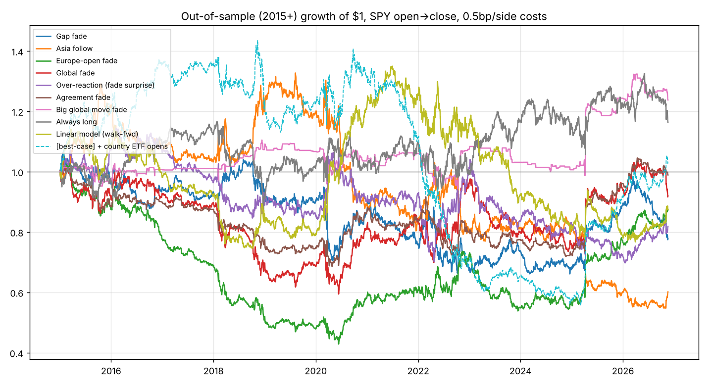
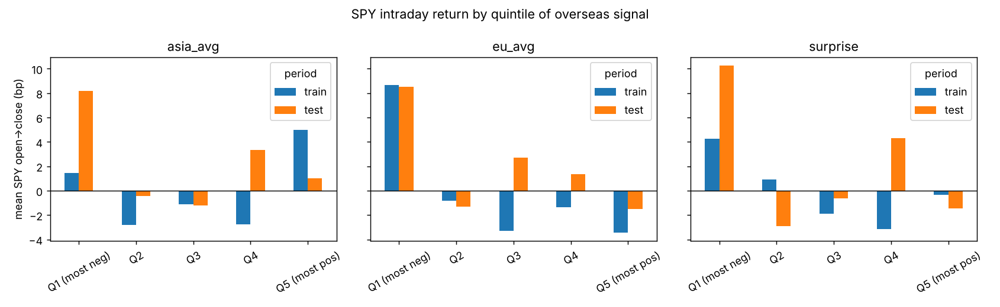

# Global open→close study (SPY)

**Question:** Can how markets in Asia and Europe have moved since the last US close predict
SPY's **open → close** return? The trade is to buy or short SPY at the 9:30 ET open and exit at the 16:00 close.

**Answer, using free daily data: no tradeable edge.** Overseas moves are already priced into
SPY's opening price. Nothing tested beat a t-stat of 1 out-of-sample after costs.

## How to run

```bash
pip install pandas numpy requests statsmodels matplotlib
python fetch_data.py   # downloads raw daily data from Yahoo into data/ (not committed)
python study.py        # builds features, writes everything to results/
```

| File | Purpose |
|---|---|
| `fetch_data.py` | Yahoo chart API download. Dates are in each exchange's **local** timezone, and prices are unrounded. |
| `features.py` | Builds a look-ahead-free table with one row per US trading day, holding only what was known at 9:30 ET. |
| `study.py` | Correlations, regressions with Newey-West t-stats, quintile buckets, strategy backtests, and checks by year and by VIX level. |
| `results/` | `summary.txt` (full console output), CSVs and charts. |

## Avoiding look-ahead

Every feature is measured from the **previous US close** to the **9:30 ET open**, accounting for
holidays and timezones:

- **Asia-Pacific** (Nikkei, Hang Seng, KOSPI, TAIEX, Shanghai, ASX 200, STI). These sessions finish
  before the US opens, so the full close-to-close return of every Asian session since the last US close is used.
- **Europe** (DAX, CAC 40, Euro Stoxx 50). The daily *close* comes at 11:30 ET, which is look-ahead,
  so the European **open** (around 3am ET) is used in its place. **FTSE 100 is excluded** because
  Yahoo's FTSE Open equals the previous close on more than 94% of days since 2000. The ASX Open has the same
  problem, but only the ASX close is needed.
- **US-listed country ETFs** (EWG, EZU, EWU, EWJ, FXI, …) open at the same moment as SPY, so they reflect
  Europe's level at 9:30 ET. Their opening print is simultaneous with your entry, so these are labeled
  **best-case**: an upper bound on what intraday European data could add.
- SPY gaps are dividend-adjusted, so ex-dividend days don't show up as false negative gaps.

Sample: Jan 2000 → Nov 2026 (6,761 days). Directions and parameters were chosen on
**2000–2014 (training period)** and evaluated on **2015–2026 (test period)**. The linear models
are refit every year using only past data.

## Findings

**1. Overseas moves are priced into the open.** Asian returns correlate +0.41 with SPY's opening
gap and European opens +0.49, but their correlation with the open→close return afterwards is between −0.07 and +0.08.
The R² of the full model is about 1%.

**2. Nothing survives the test period.** Results at 0.5bp/side costs, with follow vs. fade chosen on training data:

| Strategy | Training Sharpe | Test Sharpe | Test t-stat |
|---|---:|---:|---:|
| Always long (baseline) | −0.15 | +0.16 | +0.56 |
| Gap fade | −0.07 | −0.09 | −0.32 |
| Asia follow | +0.06 | −0.26 | −0.88 |
| Europe-open fade | +0.26 | −0.02 | −0.07 |
| Over-reaction (fade US gap vs. overseas-implied gap) | +0.18 | −0.06 | −0.21 |
| Agreement (Asia, Europe and gap agree) fade | +0.13 | +0.04 | +0.13 |
| Big overseas move (top 20%) fade | +0.21 | +0.26 | +0.90 |
| Linear model, walk-forward | +0.12 | −0.02 | −0.07 |
| Linear model, top-50% conviction | +0.23 | +0.14 | +0.49 |
| *[best-case] + country-ETF opens* | *+0.89* | *+0.09* | *+0.30* |

**3. The best-case ETF signal used to work, then stopped.** In 2005–2014 the US-listed country ETF
opens predicted SPY's intraday move (t = +3.5, Sharpe 0.89). From 2015 it disappears (t = +0.3).
This looks like an inefficiency that got traded away, which also suggests that paying for intraday
European data probably wouldn't help today.

**4. The one consistent pattern is weak and depends on a few crisis days.** After the worst 20% of
overseas sessions, SPY tends to rebound intraday: about +7.5bp per day in both training and test.
That's a t-stat of only about 1.5, and with 2020 and 2025 removed it falls to +2.8bp (t = 0.6). The
"big move fade" strategy made most of its test-period return in April 2025 (see `results/yearly_returns_pct.csv`).
That's a crisis-rebound effect, not a dependable daily edge.




## Caveats

- Yahoo's daily Open for SPY may differ slightly from the official opening-auction price you'd actually get.
- The European signal is measured at about 3am ET, not 9:30 ET. The country-ETF test bounds what
  better timing could add, and that edge disappeared after 2014.
- Many strategies were tested, so a single t-stat around 2 would not have been convincing anyway.

## Possible next steps

- **Single stocks with direct overseas exposure** (ADRs like TSM, BABA and ASML, plus multinationals). Pricing
  of individual stocks at the open is less efficient than for SPY.
- **Free intraday data for recent years** (Yahoo offers about 2 years of 1-hour bars) to measure Europe at
  9:30 ET directly, and to test exits other than the close.
- **Crisis-only rule:** fade only extreme overseas sell-offs when VIX is high. There are few such events,
  so this would need a careful study of each one.
