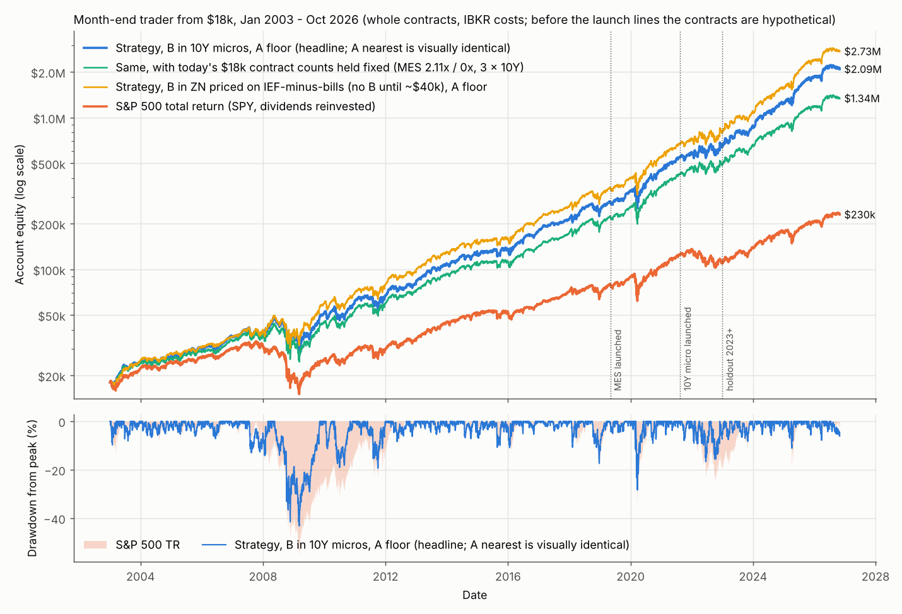

# Month-end trader, small account: $18k with leg B in CME Micro 10-Year Yield futures

Generated by `simulate_small.py` (imports `../simulate.py` for data, the leg-A signal, the SPY core, cash interest and
stats; nothing there is modified). Period **2003-01-02 to 2026-10-30**, start equity
**$18,000** unless stated. Daily Yahoo data, whole contracts, IBKR-style costs. A simulation, not live fills.

Files: `trades_18k.csv` (every trade, headline run: A floor rounding, B in 10Y with the ^TNX P&L model),
`trades_18k_nearest.csv` (same, A nearest rounding), `yearly_18k.csv`, `periods_18k.csv`, `scenarios_small.csv`
(all sizes and variants), `equity_18k.png`.

**Hypothetical periods.** MES exists since 2019-05-06 and the Micro 10Y Yield future since 2021-08-16. Every leg-A trade
before May 2019 and every leg-B trade before Aug 2021 is a *hypothetical* contract with today's specs (flagged in the
`hypothetical` column). Only Sep 2021 onward could actually have been traded this way.

## Headline: $18,000, base costs

| | A floor (headline) | A nearest | B in ZN instead (A floor) | S&P 500 TR |
|---|---|---|---|---|
| CAGR | **22.1%** | 22.1% | 23.5% | 11.3% |
| Final equity | $2,087,064 | $2,113,037 | $2,733,021 | $229,849 |
| Volatility | 20.2% | 20.2% | 19.9% | 18.5% |
| Sharpe (excess of T-bills) | 1.00 | 1.00 | 1.07 | 0.58 |
| Max drawdown | -43.2% | -42.5% | -39.5% | -55.2% |
| Beta / alpha vs S&P (daily OLS) | 0.97 / 9.8%/yr (t=5.1) | 0.97 / 9.9%/yr (t=5.1) | 0.96 / 10.9%/yr | 1.00 / 0 |
| Leg A trades / skipped (0 MES) | 286 / 0 | 286 / 0 | 286 / 0 | |
| Leg A win rate, avg net per trade | 60.8%, 0.49% ($2,506) | 60.8%, 0.50% ($2,552) | 60.8%, 0.49% | |
| Leg B trades / skipped | 286 / 0 | 286 / 0 | 226 / 60 | |
| Leg B win rate, avg net per trade | 58.4%, 0.34% ($691) | 58.4%, 0.34% | 63.3%, 0.55% | |
| Total costs (fees + slippage + SPY rebalancing) | $112,727 | $114,480 | $109,487 | |

Stress costs (2 ticks per side on MES and 10Y): A floor CAGR **20.9%**
(Sharpe 0.96), A nearest 21.0%.
Leg B priced with the IEF-minus-bills model instead of ^TNX: A floor CAGR 23.8%,
A nearest 24.0%.

The ZN contrast uses `../simulate.py` unchanged, whose leg B is priced on the IEF-minus-bills model; compare it with
the 10Y IEF-model row (23.8%), not with the ^TNX headline.
It is not "B never trades": a fresh $18k account cannot buy one ZN (needs ~$37-45k), but the account
grows, so the ZN run trades B once it gets there (60 months skipped, mostly early).

**Read this with "Starting today" below.** Started in 2003, the $18k account held ~10 MES from the first trade (the S&P was
near 900) and compounded past the point where rounding matters, so 0 months were skipped at any size. With today's
contract counts held fixed, $18k earns **19.8% (floor) / 21.2% (nearest)** CAGR, Sharpe 0.95 / 1.01.

## What changes versus `../simulate.py`

- **Leg B = short the Micro 10-Year Yield future** (short yield = long bonds) from the close of the 4th-last session to the
  month-end close. Price = 10y yield in index points (4.250 = 4.25%), 0.001 pt = $1, DV01 = $10 per contract.
  Contracts = floor(2.81 x net liq x IEF duration x 0.0001 / $10). One contract therefore stands for $100,000 / duration
  of IEF (~$14k at duration 7.1), so a fresh $18k account gets 3 contracts, ~2.4x IEF-equivalent instead of 2.81x.
- **IEF duration** (the sensitivity of IEF to the 10y yield): regression of IEF daily total returns on -(daily change in
  the 10y yield in decimal). Full sample 2003-2026: **7.12** (corr 0.947); weekly returns
  give 7.29 (the daily figure is slightly attenuated, most likely because ^TNX's daily close is not
  taken at IEF's 16:00 close);
  by period: 2003-2008 6.67, 2009-2014 7.19, 2015-2020 7.30, 2021-2026 7.41. Sizing uses the trailing
  252-session daily estimate (min 60); at the trades it ranged 6.33-7.97 (mean 7.14).
  Note: the ^TNX file in this data cache is already in percent (4.912, not 49.12), so no /10 was needed
  (the script detects the scale; detected factor 1). 6 sessions with no ^TNX print were forward-filled.
- **Two leg-B P&L models, both computed for every trade** (`gross_pnl` = headline model, `gross_pnl_alt_model` = the other):
  (b) **headline:** -contracts x (^TNX exit - ^TNX entry) x $1,000, marked daily; (a) contracts x $100,000/duration x
  (IEF total return - T-bill accrual), marked daily. On the 286 B trades of the headline run they agree
  closely: P&L correlation **0.969**, same sign on 93% of trades, tracking difference
  15bp of notional per trade. Model (a) earns on average **+4.4bp** of notional per trade
  more than (b) (+4.4bp before 2023, +4.5bp in 2023+). Gross over the whole run: (b)
  $271,250 vs (a) $381,112.
- **Why the sign: carry.** A yield future pays only the change in the yield; it has no coupon income and no financing.
  IEF minus bills earns that same yield change x duration *plus* carry = (bond yield - bill rate) x time (+ roll-down).
  With an upward-sloping curve (most of 2003-2022) carry is positive, so the IEF model beats the yield future; with the
  curve inverted (2023-2024, bills above 10s) the sign flips. Estimated carry over the 3-night hold,
  (y10 - ^IRX) x days/365: +1.5bp of notional on average (+1.8bp pre-2023,
  -0.2bp in 2023+); correlation of the per-trade model gap with that carry estimate
  0.02. **So carry explains only about a third of the gap, and the 2023+ gap stayed positive
  although carry turned negative.** Day by day, IEF-minus-bills beats the duration-scaled ^TNX move by
  0.71bp/day on ordinary days (carry 0.56bp/day: there the gap *is* carry) but by
  1.48bp/day during the B hold (carry 0.50bp/day).
  The extra ~1bp/day is month-end specific: index-extension buying lifts IEF's 7-10y basket (and the 15:00-16:00 hour,
  which ^TNX's earlier close misses) more than the on-the-run 10y yield. A yield future is tied to the on-the-run 10y, so
  it likely does **not** capture that part; that is the main reason the 10Y leg earns less than the ZN/IEF model. (Strictly, a futures price is a *forward* yield which converges to spot, so a real 10Y future
  recovers a little of the carry through convergence; real fills should land between (a) and (b), close to (b).)
  ^TNX is the Cboe cash 10y index and the futures settle to BrokerTec on-the-run yields, so the two track closely but
  not exactly; I could not get usable Micro 10Y price history (Yahoo `10Y=F` returns a single bar), so (b) uses ^TNX.
  Model (b) is clean enough to be the headline.
- **Leg A rounding:** contracts = S&P notional 2.85x (full) or 1.425x (half) of net liq(T-1) / ($5 x S&P close T-1),
  whole MES. *floor* skips the month when that rounds to 0; *nearest* rounds half up but never above 3x net liq
  (so today half-size 0.68 MES -> 1 MES at ~2.1x is allowed). Uses the actual S&P level at each trade: in 2003-2012 one
  MES was ~$4-10k of notional, so the $18k account held 6-32 MES (mean 15.3) on traded months before 2013.
- Everything else (signal, entry/exit times, 10% SPY drift band, cash interest, SPY rebalancing costs) is identical to
  `../simulate.py`. SPY is held in fractional dollars (IBKR offers fractional shares; at $18k that is ~25 SPY shares).

## Costs and margin assumptions

| Item | Base | Stress |
|---|---|---|
| MES fees (IBKR ~$0.25 + CME ~$0.35 + NFA ~$0.02) | $0.62 / contract / side | same |
| MES slippage | 1 tick = $1.25 / side | 2 ticks = $2.50 |
| Micro 10Y fees: my estimate, IBKR commission ~$0.25 + CME exchange ~$0.35-0.60 (I use the upper end) + NFA $0.02 | **$0.85 / contract / side** | same |
| Micro 10Y slippage | 1 tick = 0.001 = $1 / side | 2 ticks = $2 |
| MES initial margin | 7.5% of notional (~$2,843 today at S&P 7,580; scales with the index back in time) | x2 |
| Micro 10Y initial margin | $400 / contract (CME has been ~$300-500) | x2 |
| Cash | positive earns max(^IRX - 0.5%, 0); negative (after funding the 10Y overnight margin) pays ^IRX + 1.5% | same |

A 10Y round trip is $3.70 per contract (~$11 for the 3 contracts a fresh $18k account trades), about 0.09bp of
IEF-equivalent notional per side, vs ~0.9bp for one ZN at 1/2 tick + $1.70; the micro is cheap per unit of risk.
MES round trip $3.74 per contract.

**Liquidity.** The Micro 10Y Yield future trades far less than ZN (Yahoo's last bar shows ~900 contracts); the book is
thinner and can be several ticks wide outside the busiest hours, including around the 16:00 close. 1-3 contracts should be fillable, but use limit orders near the
mid rather than market orders, and expect occasional misses. The contracts are **monthly**; check CME's termination rule
for the front month (I believe it terminates on the last business day of the contract month) and hold the *next* month's
contract over month-end so the position is not forced out at the final settlement.

## Small-account realities

- **IBKR minimum** for a margin account ($2,000) is met at every size; the lowest equity reached in the $18k headline run was
  $16,646. Futures are not subject to the pattern-day-trader rule.
- **Margin.** Futures margin is funded by IBKR moving excess liquidity from the securities side (the 100% SPY core has
  ~75% loan value under Reg T maintenance), so it is a borrowing on top of the stock position, not separate cash.
  Highest futures initial margin at any trade (A + open B on the last day), $18k base: **30.5% of net liq** (A floor),
  30.5% (A nearest); trades above 60%: **0 / 0**. Across all sizes and variants the
  maximum was 30.7%. With SPY's 25% maintenance added the worst total requirement was 55.8% / 56.0%
  of net liq. With margins doubled (crisis) the headline run peaks at 61.0%
  (5 trades above 60%). The binding constraint is leverage, not margin.
- **Interest on negative cash** is charged when overlay losses or the 10Y margin take cash below zero (between drift-band
  rebalances); it is small: net interest over the run is $+7,024 (credit interest on
  positive cash outweighs the debit interest).
- **Rounding at today's levels** (S&P 7,580, one MES = $37,900, 10y yield 4.929%,
  duration 6.88): one MES at full size needs $13,298 of equity; at half size
  $26,597 with floor rounding, or $12,633 with nearest (3x cap).
  One 10Y contract needs only $5,176.

| account $ | A full wanted | A full floor (lev x) | A full nearest (lev x) | A half wanted | A half floor (lev x) | A half nearest (lev x) | B 10Y contracts (IEF-equiv lev x) | B ZN contracts |
|---|---|---|---|---|---|---|---|---|
| 10000 | 0.75 | 0 (0.00x) | 0 (0.00x) | 0.38 | 0 (0.00x) | 0 (0.00x) | 1 (1.45x) | 0 |
| 18000 | 1.35 | 1 (2.11x) | 1 (2.11x) | 0.68 | 0 (0.00x) | 1 (2.11x) | 3 (2.42x) | 0 |
| 25000 | 1.88 | 1 (1.52x) | 1 (1.52x) | 0.94 | 0 (0.00x) | 1 (1.52x) | 4 (2.33x) | 0 |
| 50000 | 3.76 | 3 (2.27x) | 3 (2.27x) | 1.88 | 1 (0.76x) | 2 (1.52x) | 9 (2.62x) | 1 |
| 100000 | 7.52 | 7 (2.65x) | 7 (2.65x) | 3.76 | 3 (1.14x) | 4 (1.52x) | 19 (2.76x) | 2 |

So today a fresh $18k account trades leg A only in high-vol (full-size) months with floor rounding, and every month with
nearest rounding (then at ~2.1x instead of 1.4x in calm months: nearest *over*-sizes the calm months); leg B trades 3
contracts every month.

**Months skipped by rounding at $18k.** Leg A floor: **0** of 286 months
(none); leg A nearest: **0**; leg B:
**0**. Historically the S&P was much lower, so MES rounding did not bind until the index
rose and only bites when the account is small relative to one MES; by the time the index was high the account had grown.

## Starting today: today's rounding held fixed

The compounding backtest above flatters small accounts: starting at $18k in 2003 with the S&P near 900, one MES was ~$4.5k,
so the account held ~10 MES from the first trade and rounding never bit (0 months skipped at any size). A trader
starting **today** gets today's contract counts. This scenario freezes them: MES leverage and 10Y contracts per $ of
equity are what a fresh account of that size gets at today's prices (table above), scaled with equity as it grows,
MES costs at today's cost in bp of notional. It answers "what return stream does today's rounding buy?".

| account | A floor: CAGR / Sharpe / max DD / alpha | A nearest: CAGR / Sharpe / max DD / alpha | A skipped (floor / nearest) |
|---|---|---|---|
| $10k | 13.6% / 0.70 / -53.4% / 2.3% | 13.6% / 0.70 / -53.4% / 2.3% | 286 / 286 |
| $18k | 19.8% / 0.95 / -44.1% / 7.9% | 21.2% / 1.01 / -44.1% / 9.1% | 151 / 0 |
| $25k | 18.0% / 0.89 / -45.8% / 6.4% | 19.2% / 0.93 / -48.4% / 7.3% | 151 / 0 |
| $50k | 21.0% / 0.99 / -44.5% / 8.9% | 21.5% / 1.01 / -43.5% / 9.4% | 0 / 0 |
| $100k | 22.5% / 1.03 / -42.0% / 10.2% | 22.7% / 1.03 / -43.2% / 10.3% | 0 / 0 |

At $18k today: floor = A only in high-vol months (1 MES, 2.11x) and nothing in calm months; nearest = 1 MES (2.11x) in
every month, i.e. calm months are traded at ~1.5x the intended half size. Full detail in the table below
(rows "today's rounding fixed").

| metric | $10k today's rounding fixed, A floor | $10k today's rounding fixed, A nearest | $18k today's rounding fixed, A floor | $18k today's rounding fixed, A nearest | $25k today's rounding fixed, A floor | $25k today's rounding fixed, A nearest | $50k today's rounding fixed, A floor | $50k today's rounding fixed, A nearest | $100k today's rounding fixed, A floor | $100k today's rounding fixed, A nearest |
|---|---|---|---|---|---|---|---|---|---|---|
| CAGR % | 13.55 | 13.55 | 19.83 | 21.25 | 18.00 | 19.21 | 21.01 | 21.52 | 22.54 | 22.70 |
| vol % | 17.93 | 17.93 | 19.17 | 19.30 | 18.56 | 18.97 | 19.55 | 19.48 | 19.96 | 20.08 |
| Sharpe | 0.70 | 0.70 | 0.95 | 1.01 | 0.89 | 0.93 | 0.99 | 1.01 | 1.03 | 1.03 |
| max DD % | -53.37 | -53.37 | -44.08 | -44.08 | -45.81 | -48.35 | -44.46 | -43.49 | -41.98 | -43.17 |
| beta | 0.95 | 0.95 | 0.95 | 0.95 | 0.94 | 0.96 | 0.96 | 0.95 | 0.96 | 0.97 |
| alpha %/yr | 2.31 | 2.31 | 7.90 | 9.15 | 6.38 | 7.29 | 8.88 | 9.38 | 10.21 | 10.30 |
| alpha t | 3.31 | 3.31 | 5.14 | 5.59 | 4.84 | 5.32 | 5.32 | 5.52 | 5.50 | 5.50 |
| A trades | 0.00 | 0.00 | 135.00 | 286.00 | 135.00 | 286.00 | 286.00 | 286.00 | 286.00 | 286.00 |
| A skipped | 286.00 | 286.00 | 151.00 | 0.00 | 151.00 | 0.00 | 0.00 | 0.00 | 0.00 | 0.00 |
| A win % |  |  | 63.70 | 62.24 | 63.70 | 62.24 | 62.24 | 62.24 | 62.24 | 62.24 |
| A avg % acct |  |  | 0.78 | 0.47 | 0.56 | 0.34 | 0.44 | 0.47 | 0.52 | 0.54 |
| A avg net $ |  |  | 2,573 | 1,889 | 1,938 | 1,367 | 4,801 | 5,638 | 14,582 | 15,349 |
| A avg contracts |  |  | 28.45 | 35.54 | 22.85 | 27.21 | 65.71 | 90.78 | 201.59 | 227.74 |
| A avg lev x |  |  | 2.11 | 2.11 | 1.52 | 1.52 | 1.47 | 1.87 | 1.85 | 2.05 |
| B trades | 286.00 | 286.00 | 286.00 | 286.00 | 286.00 | 286.00 | 286.00 | 286.00 | 286.00 | 286.00 |
| B skipped | 0.00 | 0.00 | 0.00 | 0.00 | 0.00 | 0.00 | 0.00 | 0.00 | 0.00 | 0.00 |
| B win % | 58.39 | 58.39 | 58.39 | 58.39 | 58.39 | 58.39 | 58.39 | 58.39 | 58.39 | 58.39 |
| B avg % acct | 0.17 | 0.17 | 0.28 | 0.28 | 0.27 | 0.27 | 0.30 | 0.30 | 0.32 | 0.32 |
| B avg net $ | 79.98 | 79.98 | 471.27 | 550.16 | 517.16 | 588.18 | 1,627 | 1,734 | 4,026 | 4,039 |
| B avg contracts | 5.65 | 5.65 | 42.33 | 52.70 | 43.05 | 51.53 | 153.26 | 166.69 | 408.49 | 416.04 |
| B avg lev x | 1.41 | 1.41 | 2.34 | 2.34 | 2.25 | 2.25 | 2.53 | 2.53 | 2.67 | 2.67 |
| max futures margin % netliq | 4.22 | 4.22 | 23.24 | 23.24 | 18.38 | 18.41 | 25.04 | 25.07 | 28.40 | 28.38 |
| trades margin > 60% | 0.00 | 0.00 | 0.00 | 0.00 | 0.00 | 0.00 | 0.00 | 0.00 | 0.00 | 0.00 |
| costs $ | 5,980 | 5,980 | 51,396 | 74,614 | 50,624 | 68,358 | 196,279 | 224,696 | 541,088 | 564,416 |
| final equity $ | 206,517 | 206,517 | 1,339,499 | 1,773,430 | 1,289,037 | 1,645,830 | 4,696,952 | 5,198,294 | 12,683,498 | 13,071,898 |

## All account sizes (base costs, B in 10Y micros, ^TNX P&L)

| metric | $10k 10Y, A floor | $10k 10Y, A nearest | $18k 10Y, A floor | $18k 10Y, A nearest | $25k 10Y, A floor | $25k 10Y, A nearest | $50k 10Y, A floor | $50k 10Y, A nearest | $100k 10Y, A floor | $100k 10Y, A nearest |
|---|---|---|---|---|---|---|---|---|---|---|
| CAGR % | 22.01 | 22.04 | 22.08 | 22.14 | 22.12 | 22.20 | 22.32 | 22.37 | 22.36 | 22.38 |
| vol % | 19.97 | 20.14 | 20.16 | 20.25 | 20.22 | 20.26 | 20.11 | 20.12 | 20.13 | 20.13 |
| Sharpe | 1.01 | 1.00 | 1.00 | 1.00 | 1.00 | 1.01 | 1.02 | 1.02 | 1.02 | 1.02 |
| max DD % | -41.55 | -41.50 | -43.17 | -42.51 | -42.81 | -42.47 | -41.24 | -41.07 | -41.30 | -41.38 |
| beta | 0.96 | 0.97 | 0.97 | 0.97 | 0.97 | 0.97 | 0.96 | 0.96 | 0.96 | 0.96 |
| alpha %/yr | 9.78 | 9.79 | 9.83 | 9.87 | 9.85 | 9.92 | 10.10 | 10.14 | 10.14 | 10.16 |
| alpha t | 5.25 | 5.14 | 5.13 | 5.10 | 5.10 | 5.10 | 5.18 | 5.18 | 5.17 | 5.17 |
| A trades | 286.00 | 286.00 | 286.00 | 286.00 | 286.00 | 286.00 | 286.00 | 286.00 | 286.00 | 286.00 |
| A skipped | 0.00 | 0.00 | 0.00 | 0.00 | 0.00 | 0.00 | 0.00 | 0.00 | 0.00 | 0.00 |
| A win % | 60.84 | 60.84 | 60.84 | 60.84 | 60.84 | 60.84 | 60.84 | 60.84 | 60.84 | 60.84 |
| A avg % acct | 0.48 | 0.50 | 0.49 | 0.50 | 0.49 | 0.50 | 0.50 | 0.50 | 0.50 | 0.50 |
| A avg net $ | 1,370 | 1,391 | 2,506 | 2,552 | 3,513 | 3,580 | 7,313 | 7,390 | 14,757 | 14,815 |
| A avg contracts | 19.70 | 20.36 | 36.53 | 37.38 | 51.18 | 52.49 | 106.28 | 107.61 | 214.61 | 215.60 |
| A avg lev x | 2.00 | 2.10 | 2.05 | 2.10 | 2.06 | 2.10 | 2.08 | 2.10 | 2.09 | 2.10 |
| B trades | 286.00 | 286.00 | 286.00 | 286.00 | 286.00 | 286.00 | 286.00 | 286.00 | 286.00 | 286.00 |
| B skipped | 0.00 | 0.00 | 0.00 | 0.00 | 0.00 | 0.00 | 0.00 | 0.00 | 0.00 | 0.00 |
| B win % | 58.39 | 58.39 | 58.39 | 58.39 | 58.39 | 58.39 | 58.39 | 58.39 | 58.39 | 58.39 |
| B avg % acct | 0.32 | 0.33 | 0.34 | 0.34 | 0.34 | 0.34 | 0.34 | 0.34 | 0.34 | 0.34 |
| B avg net $ | 372.36 | 375.51 | 690.99 | 695.46 | 964.98 | 981.25 | 2,004 | 2,020 | 4,049 | 4,056 |
| B avg contracts | 37.87 | 38.09 | 69.58 | 70.37 | 97.44 | 99.02 | 202.73 | 204.37 | 409.14 | 410.20 |
| B avg lev x | 2.62 | 2.63 | 2.71 | 2.71 | 2.74 | 2.74 | 2.77 | 2.77 | 2.79 | 2.79 |
| max futures margin % netliq | 30.34 | 30.52 | 30.49 | 30.54 | 30.59 | 30.58 | 30.61 | 30.69 | 30.65 | 30.63 |
| trades margin > 60% | 0.00 | 0.00 | 0.00 | 0.00 | 0.00 | 0.00 | 0.00 | 0.00 | 0.00 | 0.00 |
| costs $ | 61,163 | 62,099 | 112,727 | 114,480 | 157,887 | 160,959 | 328,278 | 331,431 | 662,625 | 664,809 |
| final equity $ | 1,143,663 | 1,151,210 | 2,087,064 | 2,113,037 | 2,919,010 | 2,967,096 | 6,077,657 | 6,129,968 | 12,252,437 | 12,290,265 |

## $18k variants

| metric | $18k 10Y, A floor | $18k 10Y, A nearest | $18k 10Y, A floor, stress costs | $18k 10Y, A floor, B P&L = IEF-minus-bills model | $18k 10Y, A nearest, stress costs | $18k 10Y, A nearest, B P&L = IEF-minus-bills model | $18k ZN (../simulate.py), A floor | $18k S&P 500 TR benchmark |
|---|---|---|---|---|---|---|---|---|
| CAGR % | 22.08 | 22.14 | 20.93 | 23.77 | 21.01 | 24.04 | 23.47 | 11.28 |
| vol % | 20.16 | 20.25 | 20.02 | 20.10 | 20.09 | 20.18 | 19.87 | 18.49 |
| Sharpe | 1.00 | 1.00 | 0.96 | 1.08 | 0.96 | 1.08 | 1.07 | 0.58 |
| max DD % | -43.17 | -42.51 | -43.16 | -39.68 | -42.39 | -39.33 | -39.52 | -55.19 |
| beta | 0.97 | 0.97 | 0.96 | 0.95 | 0.96 | 0.96 | 0.96 | 1.00 |
| alpha %/yr | 9.83 | 9.87 | 8.92 | 11.31 | 8.97 | 11.52 | 10.95 | -0.12 |
| alpha t | 5.13 | 5.10 | 4.69 | 5.74 | 4.69 | 5.79 | 6.03 | -0.90 |
| A trades | 286.00 | 286.00 | 286.00 | 286.00 | 286.00 | 286.00 | 286.00 |  |
| A skipped | 0.00 | 0.00 | 0.00 | 0.00 | 0.00 | 0.00 | 0.00 |  |
| A win % | 60.84 | 60.84 | 58.04 | 60.84 | 58.04 | 60.84 | 60.84 |  |
| A avg % acct | 0.49 | 0.50 | 0.44 | 0.49 | 0.44 | 0.50 | 0.49 |  |
| A avg net $ | 2,506 | 2,552 | 1,944 | 3,359 | 1,983 | 3,541 | 3,149 |  |
| A avg contracts | 36.53 | 37.38 | 30.43 | 47.25 | 31.33 | 50.02 | 44.55 |  |
| A avg lev x | 2.05 | 2.10 | 2.04 | 2.05 | 2.10 | 2.10 | 2.05 |  |
| B trades | 286.00 | 286.00 | 286.00 | 286.00 | 286.00 | 286.00 | 226.00 |  |
| B skipped | 0.00 | 0.00 | 0.00 | 0.00 | 0.00 | 0.00 | 60.00 |  |
| B win % | 58.39 | 58.39 | 58.04 | 60.14 | 58.04 | 60.14 | 63.27 |  |
| B avg % acct | 0.34 | 0.34 | 0.29 | 0.46 | 0.29 | 0.46 | 0.55 |  |
| B avg net $ | 690.99 | 695.46 | 456.20 | 1,385 | 461.33 | 1,454 | 1,686 |  |
| B avg contracts | 69.58 | 70.37 | 56.71 | 92.34 | 57.48 | 97.01 | 14.38 |  |
| B avg lev x | 2.71 | 2.71 | 2.70 | 2.72 | 2.70 | 2.72 | 2.89 |  |
| max futures margin % netliq | 30.49 | 30.54 | 30.53 | 30.56 | 30.57 | 30.62 |  |  |
| trades margin > 60% | 0.00 | 0.00 | 0.00 | 0.00 | 0.00 | 0.00 |  |  |
| costs $ | 112,727 | 114,480 | 146,774 | 148,285 | 149,620 | 156,188 | 109,487 |  |
| final equity $ | 2,087,064 | 2,113,037 | 1,665,106 | 2,896,759 | 1,691,154 | 3,048,763 | 2,733,021 | 229,849 |

## Yearly, $18k headline (A floor, base costs)

Strategy % and the A-nearest variant's % side by side; A/B P&L are for the headline run. Max DD within the calendar year.

| year | strategy % | A-nearest variant % | S&P 500 TR % | excess pp | max DD % | S&P max DD % | A net P&L $ | B net P&L $ | costs $ | interest $ | A trades | A win % | B trades | B win % | year-end equity $ |
|---|---|---|---|---|---|---|---|---|---|---|---|---|---|---|---|
| 2003 | 36.18 | 36.81 | 24.18 | 12.00 | -9.76 | -13.73 | 2,542 | -1,107 | 612.13 | -2.70 | 12 | 75.00 | 12 | 50.00 | 24,513 |
| 2004 | 10.22 | 10.08 | 10.70 | -0.48 | -6.62 | -7.53 | 365.15 | -538.70 | 502.86 | -27.43 | 12 | 58.33 | 12 | 58.33 | 27,018 |
| 2005 | 10.09 | 10.23 | 4.83 | 5.26 | -6.12 | -6.96 | 659.55 | 723.00 | 543.64 | -9.37 | 12 | 58.33 | 12 | 50.00 | 29,743 |
| 2006 | 20.82 | 20.88 | 15.85 | 4.98 | -7.13 | -7.59 | 1,083 | 429.10 | 591.98 | 31.40 | 12 | 75.00 | 12 | 50.00 | 35,936 |
| 2007 | 9.73 | 9.90 | 5.15 | 4.59 | -12.99 | -9.92 | -454.08 | 2,120 | 849.52 | 82.00 | 12 | 66.67 | 12 | 58.33 | 39,434 |
| 2008 | -3.19 | -3.26 | -36.80 | 33.60 | -41.46 | -47.12 | 12,205 | 3,787 | 1,170 | 14.27 | 12 | 91.67 | 12 | 58.33 | 38,175 |
| 2009 | 35.01 | 35.67 | 26.35 | 8.66 | -30.14 | -27.13 | 4,494 | -1,016 | 1,298 | -19.12 | 12 | 41.67 | 12 | 66.67 | 51,539 |
| 2010 | 19.77 | 19.34 | 15.06 | 4.72 | -19.07 | -15.70 | -3,828 | 6,378 | 1,443 | -26.94 | 12 | 25.00 | 12 | 83.33 | 61,730 |
| 2011 | 7.98 | 8.19 | 1.89 | 6.09 | -19.34 | -18.61 | 975.71 | 2,808 | 1,666 | -7.06 | 12 | 41.67 | 12 | 66.67 | 66,658 |
| 2012 | 23.57 | 23.35 | 15.99 | 7.58 | -8.39 | -9.69 | -947.55 | 6,309 | 1,576 | -21.80 | 12 | 50.00 | 12 | 58.33 | 82,372 |
| 2013 | 31.74 | 31.80 | 32.31 | -0.57 | -5.41 | -5.55 | 687.53 | -414.00 | 1,748 | -7.38 | 12 | 66.67 | 12 | 33.33 | 108,514 |
| 2014 | 16.74 | 16.79 | 13.46 | 3.27 | -7.16 | -7.27 | -4,014 | 7,915 | 2,097 | -6.57 | 12 | 58.33 | 12 | 66.67 | 126,677 |
| 2015 | 7.90 | 8.07 | 1.23 | 6.67 | -10.74 | -11.91 | 4,470 | 3,063 | 2,392 | -16.02 | 12 | 66.67 | 12 | 58.33 | 136,685 |
| 2016 | 32.17 | 32.36 | 12.00 | 20.17 | -8.96 | -9.19 | 12,957 | 13,312 | 2,656 | -17.29 | 12 | 83.33 | 12 | 66.67 | 180,657 |
| 2017 | 17.96 | 17.81 | 21.71 | -3.74 | -4.03 | -2.61 | -5,832 | 1,159 | 2,867 | 17.92 | 12 | 33.33 | 12 | 66.67 | 213,111 |
| 2018 | 14.39 | 14.50 | -4.57 | 18.96 | -17.37 | -19.35 | 23,572 | 17,615 | 3,741 | 126.63 | 12 | 58.33 | 12 | 75.00 | 243,788 |
| 2019 | 33.56 | 33.53 | 31.22 | 2.34 | -5.02 | -6.62 | -12,847 | 22,794 | 4,110 | 137.92 | 12 | 41.67 | 12 | 50.00 | 325,607 |
| 2020 | 38.97 | 38.91 | 18.33 | 20.64 | -28.32 | -33.72 | 25,142 | 31,877 | 5,886 | -44.25 | 12 | 58.33 | 12 | 75.00 | 452,492 |
| 2021 | 30.28 | 30.19 | 28.73 | 1.55 | -7.93 | -5.11 | 7,412 | 5,983 | 6,928 | -19.53 | 12 | 66.67 | 12 | 33.33 | 589,492 |
| 2022 | 11.02 | 11.11 | -18.18 | 29.19 | -16.65 | -24.50 | 128,564 | 52,160 | 9,588 | 100.10 | 12 | 75.00 | 12 | 50.00 | 654,445 |
| 2023 | 32.96 | 32.96 | 26.18 | 6.78 | -8.25 | -9.97 | 38,163 | 6,144 | 10,477 | 1,398 | 12 | 58.33 | 12 | 41.67 | 870,144 |
| 2024 | 43.70 | 43.82 | 24.89 | 18.81 | -5.81 | -8.41 | 99,982 | 51,980 | 13,622 | 1,126 | 12 | 75.00 | 12 | 66.67 | 1,250,373 |
| 2025 | 48.43 | 48.59 | 17.72 | 30.71 | -11.09 | -18.76 | 272,763 | 61,630 | 18,096 | 2,803 | 12 | 83.33 | 12 | 75.00 | 1,855,893 |
| 2026 | 12.46 | 12.45 | 11.69 | 0.77 | -7.82 | -8.88 | 108,604 | -97,487 | 18,267 | 1,412 | 10 | 50.00 | 10 | 40.00 | 2,087,064 |

## In-sample vs holdout ($18k)

| variant | period | CAGR % | S&P CAGR % | Sharpe | max DD % | alpha %/yr | beta | A win % | B win % | A avg % acct | B avg % acct | A skipped | B skipped |
|---|---|---|---|---|---|---|---|---|---|---|---|---|---|
| floor | 2003-2022 in-sample | 19.69 | 9.70 | 0.91 | -43.17 | 9.41 | 0.96 | 59.58 | 58.75 | 0.42 | 0.37 | 0 | 0 |
| floor | 2023+ holdout | 35.45 | 21.00 | 1.61 | -11.09 | 11.78 | 0.99 | 67.39 | 56.52 | 0.86 | 0.16 | 0 | 0 |
| floor | 2021-09+ (10Y micro live) | 28.79 | 12.00 | 1.17 | -16.65 | 14.59 | 1.00 | 66.13 | 54.84 | 0.91 | 0.33 | 0 | 0 |
| nearest | 2003-2022 in-sample | 19.75 | 9.70 | 0.91 | -42.51 | 9.45 | 0.97 | 59.58 | 58.75 | 0.43 | 0.37 | 0 | 0 |
| nearest | 2023+ holdout | 35.52 | 21.00 | 1.61 | -11.09 | 11.84 | 0.99 | 67.39 | 56.52 | 0.87 | 0.16 | 0 | 0 |
| nearest | 2021-09+ (10Y micro live) | 28.83 | 12.00 | 1.17 | -16.54 | 14.63 | 1.00 | 66.13 | 54.84 | 0.91 | 0.33 | 0 | 0 |

## Spot checks (two trades recomputed by hand)

- **A 2003-01-31 long 11 MES** (by hand from raw Yahoo files): SPX close 855.70; SPY open->close +2.270% so entry = 855.70/(1+0.02270) = 836.71; gross = +1 x 11 x $5 x (855.70 - 836.71) = $1,044.52; costs = 11 x 2 x ($0.62 + $1.25) = $41.14; net $1,003.38. Simulation: gross $1,044.52, costs $41.14, net $1,003.38. Matches.
- **B 2021-08-26 -> 2021-08-31 short 112 x 10Y** (by hand from raw Yahoo files): size = floor(2.81 x $554,651 x 7.23 x 0.0001 / $10) = floor(112.70) = 112; ^TNX 1.342 -> 1.304 (-3.8bp); gross = -112 x 1000 x (1.304 - 1.342) = $4,256.00; costs = 112 x 2 x ($0.85 + $1) = $414.40; net $3,841.60. Simulation: gross $4,256.00, costs $414.40, net $3,841.60. Matches.

## Caveats

- **In-sample.** Signals, the vol tilt and leverages (2.85x / 2.81x) were chosen on 2003-2022; only 2023+ is out of
  sample (~4 years, ~46 trades per leg). Expect live results below the backtest.
- **Hypothetical instruments.** MES before May 2019 and the Micro 10Y before Aug 2021 did not exist; those years use
  today's contract specs on index/yield data. An $18k trader in 2003-2019 would have had ES (10x coarser) and ZN (which
  this account could not afford at first).
- **Starting from $18k the account compounds** to six/seven figures in the backtest, so "small account" rounding effects
  matter only in the first years (0 months skipped at any size from $10k up). A trader starting today faces today's
  rounding; see "Starting today" (at $18k: 19.8% floor / 21.2% nearest CAGR vs 22.1% compounding; $10k cannot trade
  leg A at all, because 1 MES = 3.8x net liq exceeds even the 3x cap).
- **Leg-B model risk.** ^TNX is the cash 10y yield at Cboe's close (before IEF's 16:00), not the futures settlement; the
  real 10Y future has a small forward/convergence term. The IEF-minus-bills model earns ~4.4bp more per hold (about 1.5bp carry, the rest a
  month-end effect in IEF's basket and closing time that a yield future probably does not capture; see above).
- **Leverage and gap risk.** On the last day of the month gross exposure is SPY 1x + MES up to 2.85x (3x with nearest) + the
  bond leg ~2.3-2.8x IEF-equivalent. No stops modelled.
- **Liquidity of the Micro 10Y** (thin, few ticks wide near the close) is the main execution risk; the stress case only
  doubles slippage to 2 ticks.
- **Taxes ignored** (futures 60/40 Section 1256; SPY rebalancing realises gains).
