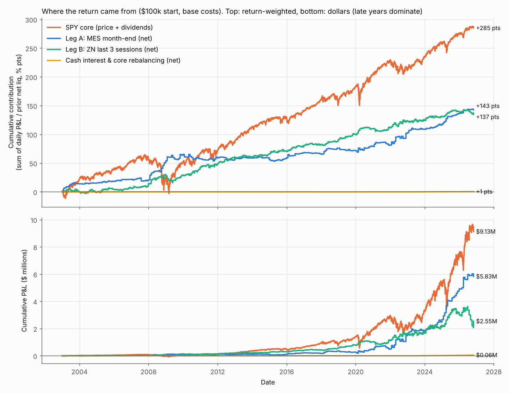

# Month-end trader: full-timeline IBKR backtest (SPY core + MES leg A + ZN leg B)

Generated by `simulate.py` (re-run it to regenerate every file here). Period **2003-01-02 to 2026-10-30**
(the last complete month; November 2026 is excluded because its month-end has not happened). Start equity
**$100,000** unless stated. All numbers are a simulation on daily Yahoo data, not live fills.

Files: `trades.csv` (one row per trade, $100k base case), `yearly.csv`, `periods.csv`, `scenarios.csv` (all account sizes and
cost cases), `equity_daily.csv`, `equity.png`, `legs_contribution.png`.

> **Read this first: independent review (round B5, 2026-11-21).** Every trade was recomputed from scratch and matches
> this simulation (direction and vol tilt 286/286 on leg A, sign 286/286 on leg B, correlation 1.000). No look-ahead
> or accounting error was found. But the headline below **overstates what the live bot would have done**:
>
> | $100k start, base costs | CAGR | Sharpe | Max DD |
> |---|---|---|---|
> | Headline below (no contract caps) | 24.3% | 1.09 | −40.5% |
> | With the bot's default caps (40 MES / 20 ZN), caps held at today's $ size | **18.9%** | 0.91 | −41.2% |
> | With the bot's hard caps (200 MES / 50 ZN) | ~21.4% | ~1.00 | −41.2% |
> | + disaster stops (6% A / 4% B, approx. from daily lows) | about −0.7pp more | | |
> | Leg B priced on real ZN futures instead of IEF−bills | about −1.4pp more | | |
>
> - The caps only start to bind once an account passes roughly $540k (leg A) / $670k (leg B) at today's prices.
>   The $17.7M final equity assumes trading 1,389 MES / 516 ZN at the end, which the bot will not do unless you raise
>   `guardrails.max_contracts` / `bond.max_contracts` (and liquidity/market impact would matter at that size).
> - A realistic expectation for the full-size bot is therefore **roughly 17–21% CAGR**, before the in-sample caveat:
>   the signals, leverages and the vol median were chosen on 2003–2022; only 2023+ (46 trades per leg) is out of sample.
> - The bot also exits leg B at 15:55 ET (12:50 on half days, 31 Dec and the days before Good Friday / Memorial Day);
>   this simulation uses 16:00 closes.

## Headline ($100k, base costs)

| | Strategy | S&P 500 TR (SPY) |
|---|---|---|
| CAGR | **24.3%** | 11.3% |
| Final equity | $17,669,863 | $1,276,941 |
| Volatility | 20.2% | 18.5% |
| Sharpe (excess of T-bills) | 1.09 | 0.58 |
| Sortino | 1.66 | 0.81 |
| Max drawdown | -40.5% | -55.2% |
| Longest drawdown (peak to recovery, calendar days) | 512 | 1772 |
| Beta / alpha vs S&P (daily OLS, excess returns) | 0.96 / 11.7%/yr (t=5.9) | 1.00 / 0 |
| Leg A: trades, win rate, avg / median net per trade (% of account) | 286, 60.8%, 0.50% / 0.18% | |
| Leg B: trades, win rate, avg / median net per trade | 286, 61.2%, 0.48% / 0.48% | |
| Profit factor A / B | 3.30 / 1.58 | |
| Best / worst trade A | 8.73% / -5.17% | |
| Best / worst trade B | 6.60% / -5.13% | |
| Total trading costs (commissions + slippage + SPY rebalancing) | $717,708 | 0 |

Stress costs (2 MES ticks, 1 ZN tick per side) at $100k: CAGR **22.5%**, Sharpe
1.03, max DD -41.7%.

## Strategy as simulated

- **Core:** 100% of net liquidation in SPY, dividends reinvested on the ex-date (DRIP, modelled with Yahoo adjusted closes).
  Futures P&L settles to cash. **Rebalancing choice: drift band.** When the SPY core drifts more than
  10% from 100% of net liq (i.e. accumulated overlay cash > +/-10%), SPY is bought/sold at the close
  back to 100%. This happened **22 times** in 24 years. Cash weight averaged 3.2%
  (range -5.5% to 10.0%). "Never rebalance" is shown as a sensitivity below: it lets overlay
  profits pile up in cash and turns the account into a low-beta overlay fund (beta 0.43, CAGR 18.1%).
- **Leg A (013 + 168 tilt):** on the last NYSE session of each month, direction = -sign(SPY MTD - TLT MTD), MTD from the prior
  month's last adjusted close to the T-1 adjusted close. Size = floor(2.85 x net liq(T-1) x tilt / (5 x S&P 500 close(T-1)))
  MES, tilt = 1 if SPY's 20-day std of daily adjusted returns (ending T-1) > 0.00837 (median over
  2002-08..2014), else 0.5. Entry 09:30, exit at the close (16:00, or 13:00 on half days per the XNYS calendar).
  **Prices:** exit = ^GSPC close; entry = ^GSPC close / (1 + SPY open-to-close return). Yahoo's ^GSPC *opens* are stale (equal
  to the prior close) on most days in 2002-2007 and many in 2011-2013, and the index's own opening print is computed from
  stale component prices anyway, so SPY's 09:30 print is the better proxy for where MES trades at the open. Futures basis
  is assumed constant intraday. MES only exists since May 2019; earlier trades are hypothetical MES at $5 x index (an ES
  trader then would have had 10x coarser rounding).
- **Leg B (276):** long ZN from the close of the 4th-last NYSE session to the close of the last session (3 overnight holds).
  Contracts = floor(2.81 x net liq x hedge ratio / (1000 x ZN=F close)). Per contract the price path is modelled as
  ZN_t = ZN_(t-1) x (1 + (IEF total return_t - T-bill accrual_t) / hedge ratio): futures earn the excess return. T-bill
  accrual = ^IRX x calendar days / 360. P&L is marked daily (variation margin to cash).
- **Hedge ratio** = beta of IEF daily returns on ZN=F daily returns, trailing 252 sessions (min 60), excluding
  Yahoo's continuous-contract roll windows (day 15-25 of Mar/Jun/Sep/Dec, 738 days). Full-sample
  2003-2026 estimate: **1.093** (corr 0.945; a weekly-return check gives
  1.107, so the daily number is only slightly attenuated by ZN settling at ~15:00 ET vs IEF at 16:00).
  The trailing value used at the trades ranged 0.89 to 1.29 (mean 1.12). The ZN notional is
  therefore ~3.1x net liq for 2.81x of IEF-equivalent exposure.
- Both legs overlap on the last session of the month, as intended.

## Costs (IBKR Pro tiered, US)

| Item | Base | Stress |
|---|---|---|
| MES all-in fees (IBKR commission ~$0.25 + CME exchange ~$0.35 + NFA/regulatory ~$0.02) | $0.62 / contract / side | same |
| MES slippage (market orders at open and close) | 1 tick = $1.25 / contract / side | 2 ticks = $2.50 |
| ZN all-in fees (IBKR ~$0.85 + CBOT exchange ~$0.80 + NFA/clearing ~$0.05; my estimate) | $1.70 / contract / side | same |
| ZN slippage | half a tick (tick = 1/64 pt = $15.625) = $7.81 / contract / side | 1 tick = $15.63 |
| SPY rebalancing | $0.0035/share (min $0.35, max 1% of value) + $0.0005/share fees + $0.005/share spread | same |
| Cash | positive cash earns max(^IRX - 0.5%, 0); negative cash (after funding ZN overnight margin of 2% of notional) pays ^IRX + 1.5% | same |

No financing on futures notional (futures P&L is an excess return). MES is never held overnight, so its margin costs no
interest (IBKR charges interest on end-of-day balances). Round trip at $100k is ~$26 for A (7 MES) and
~$38 for B (2 ZN) at today's prices; in 2003, with the S&P near 900, one MES tick was ~2.8bp per side, so
costs were ~2-3% of equity per year early on, falling to ~0.9% recently (per-year costs as a % of
equity: max 3.1% in 2009).

## All account sizes and cost cases

| metric | $25k base | $25k stress | $100k base | $100k stress | $250k base | $250k stress | $1,000k base | $1,000k stress | $100k S&P 500 TR (SPY) benchmark |
|---|---|---|---|---|---|---|---|---|---|
| CAGR % | 23.06 | 21.99 | 24.26 | 22.55 | 24.35 | 22.91 | 24.38 | 23.04 | 11.28 |
| vol % | 19.96 | 19.92 | 20.18 | 20.11 | 20.23 | 20.25 | 20.26 | 20.26 | 18.49 |
| Sharpe | 1.05 | 1.01 | 1.09 | 1.03 | 1.09 | 1.03 | 1.09 | 1.04 | 0.58 |
| Sortino | 1.59 | 1.52 | 1.66 | 1.55 | 1.66 | 1.56 | 1.66 | 1.57 | 0.81 |
| max DD % | -39.77 | -40.37 | -40.53 | -41.71 | -40.45 | -40.81 | -40.63 | -40.67 | -55.19 |
| longest DD days | 484.00 | 507.00 | 512.00 | 528.00 | 512.00 | 528.00 | 512.00 | 528.00 | 1,772 |
| beta | 0.96 | 0.96 | 0.96 | 0.96 | 0.96 | 0.96 | 0.96 | 0.96 | 1.00 |
| alpha %/yr | 10.61 | 9.73 | 11.68 | 10.29 | 11.76 | 10.56 | 11.80 | 10.68 | -0.12 |
| alpha t | 5.75 | 5.33 | 5.92 | 5.27 | 5.89 | 5.33 | 5.87 | 5.35 | -0.90 |
| A win % | 60.84 | 58.04 | 60.84 | 58.04 | 60.84 | 58.04 | 60.84 | 58.04 |  |
| B win % | 62.45 | 61.51 | 61.19 | 60.14 | 61.19 | 60.14 | 61.19 | 60.14 |  |
| A avg % acct | 0.49 | 0.44 | 0.50 | 0.44 | 0.50 | 0.44 | 0.50 | 0.44 |  |
| A median % acct | 0.18 | 0.15 | 0.18 | 0.15 | 0.18 | 0.15 | 0.18 | 0.15 |  |
| B avg % acct | 0.46 | 0.43 | 0.48 | 0.43 | 0.49 | 0.45 | 0.49 | 0.45 |  |
| B median % acct | 0.45 | 0.39 | 0.48 | 0.45 | 0.50 | 0.46 | 0.51 | 0.47 |  |
| A profit factor | 3.29 | 3.10 | 3.30 | 3.10 | 3.30 | 3.11 | 3.30 | 3.11 |  |
| B profit factor | 1.57 | 1.49 | 1.58 | 1.50 | 1.58 | 1.50 | 1.58 | 1.50 |  |
| A best % acct | 8.72 | 8.62 | 8.73 | 8.69 | 8.73 | 8.69 | 8.73 | 8.69 |  |
| A worst % acct | -4.94 | -5.16 | -5.17 | -5.24 | -5.17 | -5.27 | -5.18 | -5.28 |  |
| B best % acct | 4.91 | 5.01 | 6.60 | 6.04 | 7.10 | 7.06 | 7.06 | 7.00 |  |
| B worst % acct | -4.03 | -4.41 | -5.13 | -5.44 | -5.18 | -5.23 | -5.51 | -5.52 |  |
| A avg lev x | 2.06 | 2.06 | 2.09 | 2.09 | 2.09 | 2.09 | 2.10 | 2.10 |  |
| B avg lev x | 2.85 | 2.81 | 3.02 | 3.01 | 3.09 | 3.08 | 3.12 | 3.12 |  |
| B skipped | 33.00 | 34.00 | 0.00 | 0.00 | 0.00 | 0.00 | 0.00 | 0.00 |  |
| costs $ | 141,683 | 210,027 | 717,708 | 946,728 | 1,826,717 | 2,535,934 | 7,361,928 | 10,394,706 |  |
| final equity $ | 3,504,076 | 2,850,323 | 17,669,863 | 12,703,412 | 44,956,628 | 34,075,274 | 181,043,078 | 139,654,543 | 1,276,941 |

Sensitivities ($100k):

| metric | $100k research-equivalent (fractional, no costs, B=IEF TR, daily core rebal) | $100k fractional contracts, base costs | $100k fractional contracts, zero costs | $100k leg B priced on Yahoo ZN=F settlements instead of IEF-minus-bills, base costs | $100k never rebalance core (overlay P&L stays in cash), base costs |
|---|---|---|---|---|---|
| CAGR % | 27.75 | 24.39 | 26.59 | 22.87 | 18.05 |
| vol % | 20.76 | 20.28 | 20.28 | 20.29 | 12.73 |
| Sharpe | 1.20 | 1.09 | 1.18 | 1.03 | 1.23 |
| Sortino | 1.84 | 1.66 | 1.81 | 1.55 | 2.09 |
| max DD % | -40.46 | -40.69 | -39.00 | -42.04 | -19.89 |
| longest DD days | 506.00 | 512.00 | 484.00 | 533.00 | 437.00 |
| beta | 0.98 | 0.96 | 0.95 | 0.97 | 0.43 |
| alpha %/yr | 14.29 | 11.80 | 13.60 | 10.44 | 11.07 |
| alpha t | 6.99 | 5.85 | 6.65 | 5.39 | 5.40 |
| A win % | 62.59 | 60.84 | 62.59 | 60.84 | 60.84 |
| B win % | 63.29 | 61.19 | 61.54 | 61.19 | 61.19 |
| A avg % acct | 0.59 | 0.50 | 0.59 | 0.50 | 0.50 |
| A median % acct | 0.26 | 0.18 | 0.26 | 0.18 | 0.18 |
| B avg % acct | 0.60 | 0.49 | 0.54 | 0.39 | 0.47 |
| B median % acct | 0.58 | 0.51 | 0.56 | 0.50 | 0.49 |
| A profit factor | 3.66 | 3.30 | 3.60 | 3.25 | 2.92 |
| B profit factor | 1.89 | 1.58 | 1.67 | 1.44 | 1.74 |
| A best % acct | 8.79 | 8.73 | 8.79 | 8.73 | 8.72 |
| A worst % acct | -5.04 | -5.18 | -5.04 | -5.14 | -5.15 |
| B best % acct | 7.15 | 7.11 | 7.15 | 6.02 | 7.04 |
| B worst % acct | -5.55 | -5.60 | -5.56 | -5.40 | -5.12 |
| A avg lev x | 2.10 | 2.10 | 2.10 | 2.09 | 2.09 |
| B avg lev x | 3.13 | 3.13 | 3.13 | 3.00 | 3.00 |
| B skipped | 0.00 | 0.00 | 0.00 | 0.00 | 0.00 |
| costs $ | 0.00 | 736,795 | 286.53 | 574,723 | 323,065 |
| final equity $ | 34,190,344 | 18,111,936 | 27,512,119 | 13,508,981 | 5,211,580 |

**Rounding effect.** Accounts compound, so whole-contract rounding only bites while the account is small. The $25k account
could not trade leg B (needs 2.81 x net liq x hedge ratio >= one ZN, ~$110-140k notional) in **33 months**,
on and off between 2003-01-28 and 2009-02-24, until it had grown enough; those B trades are logged as "skipped" (0 contracts). Leg A
always traded (MES is small). Contract counts a *fresh* account would get **today** (S&P 7,580,
ZN 106.64, hedge ratio 1.04):

| account $ | A full (2.85x) | A full lev x | A half (1.425x) | A half lev x | B ZN contracts | B IEF-equiv lev x | min acct for 1 ZN $ |
|---|---|---|---|---|---|---|---|
| 25000 | 1 | 1.52 | 0 | 0.00 | 0 | 0.00 | 36,444 |
| 100000 | 7 | 2.65 | 3 | 1.14 | 2 | 2.05 | 36,444 |
| 250000 | 18 | 2.73 | 9 | 1.36 | 6 | 2.46 | 36,444 |
| 1000000 | 75 | 2.84 | 37 | 1.40 | 27 | 2.77 | 36,444 |

So a fresh $25k account today gets **1 MES at full size, 0 at half size, and no ZN at all** (minimum ~$36,444
for one ZN at 2.81x); $100k gets 7 / 3 MES and 2 ZN (2.05x instead of 2.81x for B). Rounding costs only about
0.13 pp/yr of CAGR at $100k over the full history because the account grew quickly.

## Reconciliation with research 350

350 reports CAGR 26.2% (SPY + A+B, 2003-01 to 2026-11-20, 0.5bp/1bp per side costs, A 62.2% / B 62.2% win).

| Step ($100k) | CAGR % |
|---|---|
| Research-equivalent here (fractional, zero costs, B = IEF *total* return, core rebalanced daily) | 27.75 |
| ... minus 350's 0.5bp (A) / 1bp (B) per-side costs (~0.9 pp/yr) | ~26.8 (350: 26.2; the rest is 350's window running to 2026-11-20, when the S&P was ~9% below its October close) |
| B earns IEF *minus T-bills* (correct for futures), core on a 10% band, cash interest, fractional, no costs | 26.59 |
| + IBKR fees and slippage (base) | 24.39 |
| + whole contracts (the base case) | **24.26** |
| + stress slippage | 22.55 |

The two legs reproduce 350 (A win 62.6%,
B win 63.3% before costs).
The one modelling difference that matters: **350 credits leg B with IEF's total return**, but with SPY already 100% invested
the bond exposure has to come from futures (or borrowed money), which earn only the excess over bills. That (together with the band
rebalancing and cash interest, which are small) is worth ~1.2 pp/yr in this sample and much more when bills yield 4-5% (2023+: B averages
0.31% of account per trade here vs ~0.47% in 350).

## Leg B model check against actual ZN=F prices

Over the 286 B holds, the IEF-minus-bills model and Yahoo's ZN=F settlement prices agree in sign on most
trades (return correlation 0.96, tracking error 17bp per trade) but **ZN=F made less**: mean
14.3bp per trade vs 17.1bp modelled. Re-running the whole account with B priced on ZN=F
settlements gives CAGR **22.87%** instead of 24.26%. Causes: ZN=F settles at ~15:00 ET, an hour before
the IEF close (part of the month-end bid shows up in that last hour, which the bot's 16:00 trade would capture), IEF's
cash-bond basket differs from the futures CTD, and Yahoo's continuous ZN=F holds the expiring contract through first-notice
day in Feb/May/Aug/Nov. **Treat leg B's true P&L as somewhere between the two.** In live trading, hold the next quarterly
contract in Feb/May/Aug/Nov (the front month's first notice day is the last business day of those months).

## Yearly ($100k, base costs)

Costs = futures commissions + slippage + SPY rebalancing. Max DD is within the calendar year.

| year | strategy % | S&P 500 TR % | excess pp | max DD % | S&P max DD % | A net P&L $ | B net P&L $ | costs $ | interest $ | A trades | A win % | B trades | B win % | year-end equity $ |
|---|---|---|---|---|---|---|---|---|---|---|---|---|---|---|
| 2003 | 40.78 | 24.18 | 16.60 | -9.67 | -13.73 | 14,730 | -2,270 | 3,239 | 6.28 | 12 | 75.00 | 12 | 50.00 | 140,785 |
| 2004 | 12.34 | 10.70 | 1.65 | -6.57 | -7.53 | 2,186 | 128.04 | 2,608 | -6.93 | 12 | 58.33 | 12 | 50.00 | 158,163 |
| 2005 | 11.62 | 4.83 | 6.79 | -6.75 | -6.96 | 4,136 | 6,214 | 2,945 | 36.94 | 12 | 58.33 | 12 | 50.00 | 176,540 |
| 2006 | 22.14 | 15.85 | 6.30 | -7.09 | -7.59 | 6,829 | 3,548 | 3,284 | -141.66 | 12 | 75.00 | 12 | 58.33 | 215,627 |
| 2007 | 13.25 | 5.15 | 8.10 | -12.71 | -9.92 | -2,156 | 19,618 | 4,817 | 253.26 | 12 | 66.67 | 12 | 75.00 | 244,197 |
| 2008 | 2.27 | -36.80 | 39.07 | -40.53 | -47.12 | 78,742 | 32,847 | 6,839 | 35.97 | 12 | 91.67 | 12 | 58.33 | 249,742 |
| 2009 | 42.04 | 26.35 | 15.69 | -28.09 | -27.13 | 30,858 | 6,789 | 8,110 | -37.57 | 12 | 41.67 | 12 | 66.67 | 354,739 |
| 2010 | 22.56 | 15.06 | 7.51 | -17.58 | -15.70 | -26,856 | 54,897 | 9,167 | -34.00 | 12 | 25.00 | 12 | 83.33 | 434,781 |
| 2011 | 10.11 | 1.89 | 8.21 | -19.96 | -18.61 | 7,837 | 28,551 | 10,584 | -128.13 | 12 | 41.67 | 12 | 66.67 | 478,724 |
| 2012 | 26.48 | 15.99 | 10.49 | -7.71 | -9.69 | -6,813 | 55,533 | 10,135 | -114.33 | 12 | 50.00 | 12 | 58.33 | 605,468 |
| 2013 | 32.50 | 32.31 | 0.20 | -6.07 | -5.55 | 5,499 | 1,096 | 10,917 | -31.04 | 12 | 66.67 | 12 | 41.67 | 802,269 |
| 2014 | 16.30 | 13.46 | 2.84 | -7.24 | -7.27 | -29,511 | 55,415 | 12,465 | -11.86 | 12 | 58.33 | 12 | 75.00 | 933,054 |
| 2015 | 9.25 | 1.23 | 8.02 | -10.12 | -11.91 | 34,463 | 31,886 | 14,250 | -75.99 | 12 | 66.67 | 12 | 58.33 | 1,019,374 |
| 2016 | 34.14 | 12.00 | 22.15 | -8.72 | -9.19 | 98,805 | 120,178 | 16,003 | -39.28 | 12 | 83.33 | 12 | 58.33 | 1,367,436 |
| 2017 | 19.63 | 21.71 | -2.08 | -3.99 | -2.61 | -45,804 | 22,493 | 16,805 | -675.37 | 12 | 33.33 | 12 | 75.00 | 1,635,826 |
| 2018 | 15.38 | -4.57 | 19.95 | -17.88 | -19.35 | 183,174 | 157,563 | 23,758 | -762.43 | 12 | 58.33 | 12 | 75.00 | 1,887,358 |
| 2019 | 33.93 | 31.22 | 2.70 | -5.49 | -6.62 | -100,507 | 178,038 | 24,714 | 1,452 | 12 | 41.67 | 12 | 58.33 | 2,527,655 |
| 2020 | 40.44 | 18.33 | 22.11 | -28.32 | -33.72 | 200,428 | 258,280 | 36,155 | 99.20 | 12 | 58.33 | 12 | 75.00 | 3,549,930 |
| 2021 | 31.49 | 28.73 | 2.76 | -7.54 | -5.11 | 54,449 | 92,035 | 42,035 | -52.63 | 12 | 66.67 | 12 | 50.00 | 4,667,785 |
| 2022 | 12.17 | -18.18 | 30.34 | -17.87 | -24.50 | 1,033,077 | 480,656 | 61,869 | 30.13 | 12 | 75.00 | 12 | 58.33 | 5,235,807 |
| 2023 | 33.54 | 26.18 | 7.36 | -8.72 | -9.97 | 306,551 | 73,886 | 67,376 | 14,076 | 12 | 58.33 | 12 | 41.67 | 6,991,865 |
| 2024 | 45.39 | 24.89 | 20.51 | -5.74 | -8.41 | 815,302 | 518,121 | 89,987 | 12,396 | 12 | 75.00 | 12 | 66.67 | 10,165,766 |
| 2025 | 51.62 | 17.72 | 33.90 | -12.05 | -18.76 | 2,255,207 | 806,736 | 120,226 | 11,561 | 12 | 83.33 | 12 | 75.00 | 15,413,219 |
| 2026 | 14.64 | 11.69 | 2.95 | -7.16 | -8.88 | 912,912 | -455,398 | 119,421 | 20,691 | 10 | 50.00 | 10 | 40.00 | 17,669,863 |

## In-sample vs holdout

| period | CAGR % | S&P CAGR % | Sharpe | max DD % | alpha %/yr | beta | A win % | B win % | A avg % acct | B avg % acct |
|---|---|---|---|---|---|---|---|---|---|---|
| 2003-2014 | 20.47 | 9.45 | 0.94 | -40.53 | 10.41 | 0.94 | 59.03 | 61.11 | 0.39 | 0.46 |
| 2015-2022 | 24.09 | 10.08 | 1.09 | -28.32 | 12.63 | 0.98 | 60.42 | 63.54 | 0.49 | 0.58 |
| 2023+ holdout | 37.47 | 21.00 | 1.66 | -12.05 | 13.16 | 1.00 | 67.39 | 56.52 | 0.86 | 0.31 |
| 2003-2022 in-sample | 21.89 | 9.70 | 1.00 | -40.53 | 11.31 | 0.95 | 59.58 | 62.08 | 0.43 | 0.51 |

The sizing rule, leverages (2.85x / 2.81x) and the vol median come from 2003-2014 data and the legs were selected on
2003-2022, so **only 2023+ is out of sample** (about four years, 46 trades per leg).

## Caveats

- **In-sample.** 2003-2022 was used to discover and select both signals, the vol tilt and the leverage. The holdout
  (2023-2026) looks strong for A and weaker for B; four years is short. Expect live results below the backtest.
- **Leverage and gap risk.** Leg A puts up to 2.85x net liq on top of a 100% SPY core for one session, leg B ~3x in ZN
  notional for three nights: total gross exposure is ~7x on the last day of the month. The worst single A day here cost
  5.2% of the account and the worst B hold 5.1%; a crash-day (Oct 1987-style -20%)
  on a month-end with A long at full size would cost ~57% of the account *on top of* the core's loss. **No stops are
  modelled** (the bot has a disaster stop; its effect is not in these numbers).
- **Fills.** Open/close fills are modelled from daily bars plus fixed tick slippage. Real 09:30 MES fills can be wider in fast
  markets (the stress case doubles slippage), and month-end closes are crowded. ZN liquidity at 16:00 ET (after the 15:00 settlement) is
  thinner than during the day session.
- **Data limits.** Yahoo daily data (adjusted closes for dividends; ^GSPC opens unreliable before ~2014, so SPY opens are used);
  ^IRX as the bills/benchmark rate; ZN=F is a non-back-adjusted continuous contract with roll jumps (excluded only from the
  hedge-ratio estimate). MES did not exist before 2019. No survivorship issue (index products).
- **Margin.** MES intraday margin and ZN overnight margin (~2% of notional) are assumed always available against a 100% SPY
  core (IBKR lends against SPY). A margin call or IBKR raising margins in a crisis could force a smaller size.
- **Taxes ignored.** Futures are 60/40 Section 1256 in the US; SPY rebalancing realises gains.
- **Rebalancing choice matters.** With no core rebalancing, overlay profits accumulate as cash and the account de-risks
  (see "never rebalance" above).
