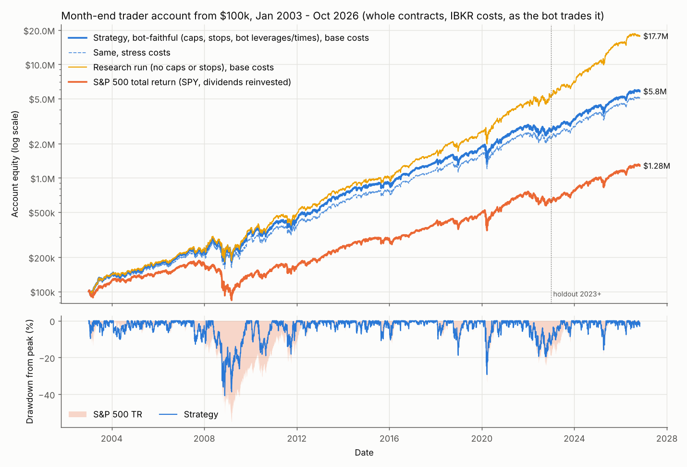

# Month-end trader: full-timeline IBKR backtest (SPY core + MES leg A + ZN leg B)

Generated by `simulate.py` (re-run it to regenerate every file here). Period **2003-01-02 to 2026-10-30**
(the last complete month; November 2026 is excluded because its month-end has not happened). Start equity
**$100,000** unless stated. All numbers are a simulation on daily Yahoo data, not live fills.

**The headline is the bot-faithful run** (`BOT_FAITHFUL = True` at the top of `simulate.py`): the live bot's default
leverages, contract and leverage caps, disaster stops and leg-B trade times (`../met`, `config.example.yaml`). This
replaces the earlier headline (24.3% CAGR), which had no caps or stops and research leverages; that run is kept as the
"no caps (research)" column and is reproduced exactly with `BOT_FAITHFUL = False`.

Files: `trades.csv` (one row per trade, $100k bot-faithful base case; `exit_reason` marks disaster stops),
`yearly.csv`, `periods.csv`, `scenarios.csv` (all account sizes, cost cases and variants), `equity_daily.csv`,
`equity.png`, `legs_contribution.png`.

## Headline ($100k, base costs)

| | Bot-faithful (default caps, stops, bot leverages and times) | Hard caps (200 MES / 50 ZN) | No caps (research run) | Leg B on ZN=F prices (bot-faithful) | No contract caps (else bot-faithful) | S&P 500 TR (SPY) |
|---|---|---|---|---|---|---|
| CAGR | **18.5%** | 21.4% | 24.3% | 18.1% | 23.7% | 11.3% |
| Final equity | **$5,762,741** | $10,115,259 | $17,669,863 | $5,241,775 | $15,818,773 | $1,276,941 |
| Volatility | **18.9%** | 19.5% | 20.2% | 19.2% | 20.2% | 18.5% |
| Sharpe (excess of T-bills) | **0.90** | 1.00 | 1.09 | 0.87 | 1.07 | 0.58 |
| Sortino | **1.33** | 1.49 | 1.66 | 1.27 | 1.62 | 0.81 |
| Max drawdown | **-40.8%** | -40.8% | -40.5% | -44.3% | -40.8% | -55.2% |
| Longest drawdown (calendar days) | **528** | 528 | 512 | 554 | 528 | 1772 |
| Beta / alpha vs S&P (%/yr, t) | **0.94 / 6.9 (t=4.6)** | 0.95 / 9.3 (t=5.3) | 0.96 / 11.7 (t=5.9) | 0.96 / 6.4 (t=4.3) | 0.96 / 11.2 (t=5.6) | 1.00 / 0 |
| Leg A trades, win rate | **286, 60.8%** | 286, 60.8% | 286, 60.8% | 286, 60.8% | 286, 60.8% | |
| Leg A avg / median net per trade (% of acct) | **0.27% / 0.12%** | 0.40% / 0.18% | 0.50% / 0.18% | 0.27% / 0.13% | 0.49% / 0.18% | |
| Leg B trades, win rate | **286, 62.2%** | 286, 62.2% | 286, 61.2% | 286, 61.9% | 286, 62.2% | |
| Leg B avg / median net per trade (% of acct) | **0.30% / 0.21%** | 0.38% / 0.33% | 0.48% / 0.48% | 0.26% / 0.21% | 0.44% / 0.49% | |
| Profit factor A / B | **1.90 / 2.07** | 2.43 / 2.09 | 3.30 / 1.58 | 1.91 / 1.87 | 3.27 / 1.59 | |
| Worst trade A / B (% of acct) | **-5.05% / -4.10%** | -5.05% / -4.10% | -5.17% / -5.13% | -5.07% / -4.10% | -5.05% / -4.10% | |
| Avg leverage A / B (notional / net liq) | **1.44x / 2.02x** | 1.88x / 2.46x | 2.09x / 3.02x | 1.48x / 2.09x | 2.05x / 3.06x | |
| Disaster stops fired A / B | **0 / 9** | 0 / 9 | 0 / 0 | 0 / 7 | 0 / 10 | |
| Trading costs | **$169,419** | $323,065 | $717,708 | $163,175 | $636,259 | |

Columns: *hard caps* = bot-faithful with `guardrails.max_contracts` / `bond.max_contracts` raised to the code's hard
limits (200 MES, 50 ZN); *no caps (research)* = the previous headline (no caps, no stops, 2.85x / 2.81x x trailing beta,
16:00 closes); *ZN=F* = bot-faithful with leg B priced on Yahoo ZN=F closes (roll days neutralised) instead of IEF minus
bills; *no contract caps* = bot-faithful with the 3x / 4.5x / 7x leverage caps but no contract caps.
Stress costs (2 MES ticks, 1 ZN tick per side), bot-faithful $100k: CAGR **17.8%**,
Sharpe 0.87, max DD -42.1%.

### From the research run to the bot ($100k, base costs)

| Step | CAGR | Sharpe | Max DD | Stops A / B |
|---|---|---|---|---|
| Research run (BOT_FAITHFUL=False): no caps or stops, 2.85x / 2.81x x trailing beta, 16:00 closes | 24.26% | 1.09 | -40.5% | 0 / 0 |
| + bot leverages: A 2.8x (vol tilt 0.5), B 2.8 x fixed 1.14 | 24.10% | 1.08 | -41.2% | 0 / 0 |
| + bot leg-B times (12:50 days at the previous close) | 24.29% | 1.09 | -40.7% | 0 / 0 |
| + default caps: 40 MES / 20 ZN (today's $), 3x A / 4.5x B / 7x total | 18.95% | 0.92 | -40.7% | 0 / 0 |
| + disaster stops (6% A / 4% B) = **bot-faithful headline** | 18.55% | 0.90 | -40.8% | 0 / 9 |

Sensitivities around the headline:

| Variant | CAGR | Sharpe | Max DD | Stops A / B |
|---|---|---|---|---|
| Caps as literal contract counts (40 MES / 20 ZN at every date) | 17.78% | 0.89 | -46.8% | 0 / 9 |
| A stop on raw SPY highs/lows (no ^GSPC, no bad-print filter) | 17.88% | 0.86 | -48.3% | 4 / 9 |
| ZN=F pricing and hard caps | 20.89% | 0.97 | -44.3% | 0 / 7 |
| Never rebalance the core | 14.88% | 1.08 | -21.7% | 0 / 9 |

### Stop-level sensitivity ($100k, bot-faithful otherwise)

| Leg-B disaster stop | CAGR | Worst leg-B trade (% of account) |
|---|---|---|
| 4% (bot default) | 18.55% | −4.1% |
| 6% | 18.85% | −6.1% |
| 8% / off | 18.95% | −6.9% |

The 4% stop costs ~0.4pp a year: most stopped windows recovered by month-end. It is insurance against a larger gap
(e.g. a CPI/FOMC shock during the hold), which the 2003–2026 sample barely contains. Set `bond.disaster_stop_pct_equity`
to taste; leg A's 6% stop never fired on clean data.

## What "bot-faithful" means here

- **Leverages** (`config.example.yaml`): leg A `strategy.leverage` 2.8 at full size, x0.5 when SPY's 20-day vol
  (T-1) is at or below 0.008369 (the bot's fixed copy of the 2002-08..2014 median; recomputed here:
  0.008369). Leg B `bond.leverage` 2.8 x the fixed hedge ratio 1.14 = ZN notional
  3.19x net liq (the research run used 2.81 x the trailing beta, mean 1.12).
  Leg B's *P&L* is still modelled with the trailing beta (IEF excess return / beta, mean 1.12 at the trades),
  so the fixed 1.14 changes only the size.
- **Caps**, with the bot's own sizing function (`met.guardrails.size_contracts`, imported): A <= 40 MES and <=
  3.0x net liq; B <= 20 ZN and <= 4.5x; A is skipped if A + open B notional > 7.0x
  (`guardrails.max_total_leverage`; it never bound: 0 months blocked). **Contract caps are applied in today's
  dollars** (`CAP_MODE = "today_usd"`): N contracts at today's prices (S&P 7,580, ZN
  106.64), converted to contracts at each date's price, so a 2003 account is not capped at 40 x $4.5k
  MES. At today's prices the default caps bind above about **$541,434** of equity (A, full size) and
  **$668,174** (B). In this run they first bound on 2013-04-30 (134 A trades capped) and 2013-07-26 (158 B trades capped). Literal
  contract counts at every date are a sensitivity above (17.8% CAGR).
- **Disaster stops.** Leg A flattens when the MES overlay is down 6% of the morning's net liq
  (`guardrails.disaster_stop_pct_equity`, checked every 15 s); leg B when the ZN overlay is down 4% of the entry net liq
  (`bond.disaster_stop_pct_equity`, whenever CBOT trades during the hold). Approximation at daily resolution: A's worst
  intraday move from the 09:30 entry = ^GSPC low (long) / high (short) vs the entry level; **sanity filter:** an
  ^GSPC extreme equal to the index's own opening print is ignored (the official open is computed from stale component
  prices: 2008-09-30, 2011-11-30, 2012-06-29 and many 2002-2013 days), then SPY's extreme vs its open is used, unless it
  lies beyond the prior close against an opening gap above 1% (the bad-print pattern on 2008-09-30, SPY low
  110.53 vs open 113.51 on a +1.9% gap day that closed at 115.99, and 2011-11-30, low 120.00 vs open 123.49, close 124.99);
  if both are rejected only the close counts. Sources used over the 286 A trades: {'^GSPC': 245, 'SPY (^GSPC extreme = open print)': 38, 'close only (^GSPC open print, SPY bad print)': 3}.
  B's worst price each hold day = the model's prior close x (ZN=F low / ZN=F prior close), and the close itself;
  ZN=F lows above the close or more than 1% below both closes are treated as bad prints (2 days in
  the whole file). The entry day (B enters 2 minutes before the close) and 12:50 exit days are not checked. **A stop fills
  at the stop level plus 1 extra tick**, plus the normal exit slippage and fees.
- **Leg-B times.** The bot enters at 15:58 and exits at 15:55 ET; the daily close stands in for both. On 12:50 ET days
  (NYSE half days and SIFMA early closes: 31 Dec, the sessions before Good Friday and Memorial Day; `met.bond.rates_early`)
  the trade price is approximated by the **previous session's close**: an early entry earns that day's move (sized on the
  previous close's net liq), an early exit forgoes it. 8 entries and 29 exits fell on such days.

## Disaster stops in the headline run

**0 leg-A and 9 leg-B stops fired.** Each stopped trade lost the stop amount plus costs
(~4% / 6% of equity); the last column is what the same trade returned in the run without stops (held to the
normal exit):

| Leg | Entry | Stopped | Contracts | Net (% of acct) | Without the stop (exit) |
|---|---|---|---|---|---|
| B | 2003-07-28 | 2003-07-31 | 3 | -4.08% | -2.19% (2003-07-31) |
| B | 2004-01-27 | 2004-01-28 | 4 | -4.10% | -1.34% (2004-01-30) |
| B | 2008-05-27 | 2008-05-29 | 7 | -4.08% | -2.84% (2008-05-30) |
| B | 2009-01-27 | 2009-01-29 | 5 | -4.08% | -6.91% (2009-01-30) |
| B | 2009-02-24 | 2009-02-26 | 5 | -4.08% | -3.91% (2009-02-27) |
| B | 2009-04-27 | 2009-04-29 | 6 | -4.09% | -4.15% (2009-04-30) |
| B | 2009-05-26 | 2009-05-28 | 6 | -4.08% | 1.53% (2009-05-29) |
| B | 2010-08-26 | 2010-08-30 | 8 | -4.09% | 0.09% (2010-08-31) |
| B | 2011-06-27 | 2011-06-29 | 10 | -4.08% | -4.71% (2011-06-30) |

Leg A: no stop fired. Closest calls (>= 70% of the way to the stop): 2007-07-31 long 2.79x: adverse 1.83% (85% of the stop distance, ^GSPC); 2010-01-29 long 2.81x: adverse 1.72% (81% of the stop distance, ^GSPC); 2010-05-28 long 2.78x: adverse 1.57% (73% of the stop distance, ^GSPC); 2009-03-31 short 2.83x: adverse 1.53% (72% of the stop distance, ^GSPC); 2009-06-30 long 2.79x: adverse 1.53% (71% of the stop distance, ^GSPC). With raw SPY highs/lows instead
(no ^GSPC, no filter) the A stops would have been: 2007-07-31 (-6.19%, -5.05% if held), 2008-09-30 (-6.25%, +6.11% if held), 2009-05-29 (-6.31%, -3.63% if held), 2011-11-30 (-6.23%, +3.32% if held) (CAGR 17.9%).

### Spot checks (stop trades recomputed by hand)

- **B 2003-07-28 -> stopped 2003-07-31: long 3 ZN** (by hand from the raw Yahoo files): entry ZN=F close 112.3281, net liq $129,776; stop level = 112.3281 - 4% x 129,776 / (3 x 1000) = 110.5978; 07-29: ZN=F low 111.047 vs prior close 112.328 (-1.14%) -> worst model price 112.328 x (1-0.0114) = 111.047; close (IEF -0.975% - bills, / 1.029) = 111.260; 07-30: ZN=F low 111.266 vs prior close 111.531 (-0.24%) -> worst model price 111.260 x (1-0.0024) = 110.995; close (IEF +0.805% - bills, / 1.029) = 112.128; 07-31: ZN=F low 110.062 vs prior close 111.938 (-1.68%) -> worst model price 112.128 x (1-0.0168) = 110.250; fill 110.5978 - 1/64 = 110.5821; gross 3 x 1000 x (110.5821 - 112.3281) = $-5,237.91; costs $57.07; net $-5,294.98 = -4.08% of equity. Simulation: exit 2003-07-31, net $-5,294.98 (-4.08%). Matches.
- **B 2004-01-27 -> stopped 2004-01-28: long 4 ZN** (by hand from the raw Yahoo files): entry ZN=F close 114.0000, net liq $145,644; stop level = 114.0000 - 4% x 145,644 / (4 x 1000) = 112.5436; 01-28: ZN=F low 112.500 vs prior close 114.000 (-1.32%) -> worst model price 114.000 x (1-0.0132) = 112.500; fill 112.5436 - 1/64 = 112.5279; gross 4 x 1000 x (112.5279 - 114.0000) = $-5,888.25; costs $76.10; net $-5,964.35 = -4.10% of equity. Simulation: exit 2004-01-28, net $-5,964.35 (-4.10%). Matches.

## Strategy as simulated

- **Core:** 100% of net liquidation in SPY, dividends reinvested on the ex-date (DRIP, modelled with Yahoo adjusted closes).
  Futures P&L settles to cash. **Rebalancing choice: drift band.** When the SPY core drifts more than
  10% from 100% of net liq (i.e. accumulated overlay cash > +/-10%), SPY is bought/sold at the close
  back to 100%. This happened **15 times** in 24 years. Cash weight averaged 3.9%
  (range -7.9% to 10.0%). "Never rebalance" is a sensitivity above
  (beta 0.46, CAGR 14.9%).
- **Leg A (013 + 168 tilt):** on the last NYSE session of each month, direction = -sign(SPY MTD - TLT MTD), MTD from the prior
  month's last adjusted close to the T-1 adjusted close. Size = the bot's sizing of 2.8 x tilt x net liq(T-1) at the
  S&P 500 close(T-1), floor, capped as above. Entry 09:30, exit at the close (16:00, or 13:00 on half days per the XNYS
  calendar) unless stopped.
  **Prices:** exit = ^GSPC close; entry = ^GSPC close / (1 + SPY open-to-close return). Yahoo's ^GSPC *opens* are stale (equal
  to the prior close) on most days in 2002-2007 and many in 2011-2013, and the index's own opening print is computed from
  stale component prices anyway, so SPY's 09:30 print is the better proxy for where MES trades at the open. Futures basis
  is assumed constant intraday. MES only exists since May 2019; earlier trades are hypothetical MES at $5 x index.
- **Leg B (276):** long ZN from the 4th-last NYSE session to the last session (3 overnight holds), times as above.
  Contracts = floor(2.8 x 1.14 x net liq / (1000 x ZN=F close)), capped. Per contract the price path is modelled as
  ZN_t = ZN_(t-1) x (1 + (IEF total return_t - T-bill accrual_t) / trailing beta): futures earn the excess return. T-bill
  accrual = ^IRX x calendar days / 360. P&L is marked daily (variation margin to cash).
- **Trailing beta** = beta of IEF daily returns on ZN=F daily returns, trailing 252 sessions (min 60), excluding
  Yahoo's continuous-contract roll windows (day 15-25 of Mar/Jun/Sep/Dec, 738 days). Full-sample
  estimate: **1.093** (corr 0.945; weekly returns 1.107).
- Both legs overlap on the last session of the month, as intended (unless B was stopped earlier or exits at 12:50).

## Costs (IBKR Pro tiered, US)

| Item | Base | Stress |
|---|---|---|
| MES all-in fees (IBKR commission ~$0.25 + CME exchange ~$0.35 + NFA/regulatory ~$0.02) | $0.62 / contract / side | same |
| MES slippage (market orders at open and close) | 1 tick = $1.25 / contract / side | 2 ticks = $2.50 |
| ZN all-in fees (IBKR ~$0.85 + CBOT exchange ~$0.80 + NFA/clearing ~$0.05; my estimate) | $1.70 / contract / side | same |
| ZN slippage | half a tick (tick = 1/64 pt = $15.625) = $7.81 / contract / side | 1 tick = $15.63 |
| Disaster-stop fills | stop level + 1 tick, then the normal slippage | same |
| SPY rebalancing | $0.0035/share (min $0.35, max 1% of value) + $0.0005/share fees + $0.005/share spread | same |
| Cash | positive cash earns max(^IRX - 0.5%, 0); negative cash (after funding ZN overnight margin of 2% of notional) pays ^IRX + 1.5% | same |

No financing on futures notional (futures P&L is an excess return). MES is never held overnight. Per-year costs as a % of
equity: ~0.14% recently, max 3.1% in 2009.

## All account sizes and cost cases (bot-faithful)

| metric | $25k base | $25k stress | $100k base | $100k stress | $250k base | $250k stress | $1,000k base | $1,000k stress | $100k S&P 500 TR (SPY) benchmark |
|---|---|---|---|---|---|---|---|---|---|
| CAGR % | 20.97 | 20.58 | 18.55 | 17.84 | 16.86 | 16.52 | 13.61 | 13.43 | 11.28 |
| vol % | 19.38 | 19.50 | 18.88 | 18.86 | 18.67 | 18.53 | 17.57 | 17.96 | 18.49 |
| Sharpe | 0.99 | 0.97 | 0.90 | 0.87 | 0.84 | 0.82 | 0.72 | 0.70 | 0.58 |
| Sortino | 1.47 | 1.44 | 1.33 | 1.28 | 1.22 | 1.20 | 1.02 | 0.99 | 0.81 |
| max DD % | -39.74 | -39.95 | -40.78 | -42.12 | -41.24 | -42.05 | -45.64 | -47.84 | -55.19 |
| longest DD days | 498.00 | 507.00 | 528.00 | 538.00 | 555.00 | 538.00 | 689.00 | 695.00 | 1,772 |
| beta | 0.95 | 0.96 | 0.94 | 0.94 | 0.94 | 0.94 | 0.94 | 0.96 | 1.00 |
| alpha %/yr | 8.87 | 8.53 | 6.92 | 6.34 | 5.40 | 5.16 | 2.44 | 2.14 | -0.12 |
| alpha t | 5.43 | 5.14 | 4.59 | 4.18 | 3.98 | 3.84 | 4.24 | 3.62 | -0.90 |
| A win % | 60.84 | 58.04 | 60.84 | 58.04 | 60.84 | 58.04 | 60.84 | 58.04 |  |
| B win % | 63.91 | 62.73 | 62.24 | 61.54 | 62.59 | 61.54 | 62.94 | 61.89 |  |
| A avg % acct | 0.37 | 0.33 | 0.27 | 0.23 | 0.24 | 0.20 | 0.10 | 0.09 |  |
| A median % acct | 0.18 | 0.15 | 0.12 | 0.10 | 0.07 | 0.06 | 0.03 | 0.03 |  |
| B avg % acct | 0.40 | 0.39 | 0.30 | 0.30 | 0.21 | 0.22 | 0.11 | 0.10 |  |
| B median % acct | 0.44 | 0.40 | 0.21 | 0.22 | 0.12 | 0.13 | 0.06 | 0.06 |  |
| A profit factor | 2.32 | 2.29 | 1.90 | 1.78 | 1.95 | 1.77 | 2.00 | 1.80 |  |
| B profit factor | 1.91 | 1.80 | 2.07 | 1.98 | 1.96 | 1.91 | 2.04 | 1.92 |  |
| A best % acct | 7.75 | 7.61 | 8.01 | 7.91 | 8.06 | 7.97 | 3.49 | 3.39 |  |
| A worst % acct | -4.90 | -5.17 | -5.05 | -5.14 | -5.00 | -5.08 | -1.34 | -1.41 |  |
| B best % acct | 6.79 | 6.78 | 7.85 | 7.38 | 7.86 | 8.03 | 3.64 | 3.81 |  |
| B worst % acct | -4.10 | -4.11 | -4.10 | -4.14 | -4.10 | -4.14 | -3.05 | -3.25 |  |
| A avg lev x | 1.81 | 1.84 | 1.44 | 1.50 | 1.09 | 1.12 | 0.48 | 0.50 |  |
| B avg lev x | 2.44 | 2.48 | 2.02 | 2.12 | 1.56 | 1.60 | 0.66 | 0.69 |  |
| B skipped | 20.00 | 15.00 | 0.00 | 0.00 | 0.00 | 0.00 | 0.00 | 0.00 |  |
| A stops | 0.00 | 0.00 | 0.00 | 0.00 | 0.00 | 0.00 | 0.00 | 0.00 |  |
| B stops | 4.00 | 3.00 | 9.00 | 9.00 | 11.00 | 8.00 | 0.00 | 0.00 |  |
| costs $ | 82,189 | 136,907 | 169,419 | 279,544 | 234,601 | 403,749 | 273,251 | 470,291 |  |
| final equity $ | 2,330,361 | 2,159,985 | 5,762,741 | 4,995,427 | 10,233,886 | 9,555,769 | 20,889,030 | 20,132,915 | 1,276,941 |

All $100k variants:

| metric | $100k bot-faithful (default caps, stops, bot leverages and times) | $100k hard caps (200 MES / 50 ZN), else bot-faithful | $100k no contract caps, else bot-faithful | $100k no caps (research run: BOT_FAITHFUL=False) | $100k leg B priced on ZN=F (roll days neutralised), else bot-faithful | $100k research + bot leverages (2.8 / 2.8 x 1.14) | $100k   + bot leg-B times | $100k   + default caps (40 MES / 20 ZN, 3x / 4.5x / 7x) | $100k bot-faithful, caps as literal contract counts | $100k bot-faithful, A stop on raw SPY highs/lows | $100k bot-faithful, ZN=F pricing and hard caps | $100k bot-faithful, never rebalance core | $100k research-equivalent (fractional, no costs, B=IEF TR, daily core rebal) | $100k research settings, fractional contracts, zero costs | $100k research settings, fractional contracts, base costs |
|---|---|---|---|---|---|---|---|---|---|---|---|---|---|---|---|
| CAGR % | 18.55 | 21.38 | 23.68 | 24.26 | 18.08 | 24.10 | 24.29 | 18.95 | 17.78 | 17.88 | 20.89 | 14.88 | 27.75 | 26.59 | 24.39 |
| vol % | 18.88 | 19.54 | 20.20 | 20.18 | 19.16 | 20.21 | 20.22 | 18.96 | 18.21 | 19.20 | 19.71 | 11.92 | 20.76 | 20.28 | 20.28 |
| Sharpe | 0.90 | 1.00 | 1.07 | 1.09 | 0.87 | 1.08 | 1.09 | 0.92 | 0.89 | 0.86 | 0.97 | 1.08 | 1.20 | 1.18 | 1.09 |
| Sortino | 1.33 | 1.49 | 1.62 | 1.66 | 1.27 | 1.64 | 1.65 | 1.34 | 1.29 | 1.26 | 1.45 | 1.70 | 1.84 | 1.81 | 1.66 |
| max DD % | -40.78 | -40.78 | -40.78 | -40.53 | -44.29 | -41.24 | -40.67 | -40.67 | -46.81 | -48.29 | -44.29 | -21.73 | -40.46 | -39.00 | -40.69 |
| longest DD days | 528.00 | 528.00 | 528.00 | 512.00 | 554.00 | 528.00 | 512.00 | 525.00 | 665.00 | 689.00 | 554.00 | 266.00 | 506.00 | 484.00 | 512.00 |
| beta | 0.94 | 0.95 | 0.96 | 0.96 | 0.96 | 0.96 | 0.96 | 0.95 | 0.93 | 0.94 | 0.96 | 0.46 | 0.98 | 0.95 | 0.96 |
| alpha %/yr | 6.92 | 9.31 | 11.22 | 11.68 | 6.38 | 11.55 | 11.70 | 7.19 | 6.26 | 6.39 | 8.84 | 7.83 | 14.29 | 13.60 | 11.80 |
| alpha t | 4.59 | 5.29 | 5.65 | 5.92 | 4.28 | 5.83 | 5.89 | 4.85 | 5.08 | 3.86 | 5.00 | 4.62 | 6.99 | 6.65 | 5.85 |
| A win % | 60.84 | 60.84 | 60.84 | 60.84 | 60.84 | 60.84 | 60.84 | 60.84 | 60.84 | 60.14 | 60.84 | 60.84 | 62.59 | 62.59 | 60.84 |
| B win % | 62.24 | 62.24 | 62.24 | 61.19 | 61.89 | 61.19 | 62.94 | 62.94 | 62.59 | 62.59 | 61.89 | 62.59 | 63.29 | 61.54 | 61.19 |
| A avg % acct | 0.27 | 0.40 | 0.49 | 0.50 | 0.27 | 0.49 | 0.49 | 0.27 | 0.15 | 0.19 | 0.42 | 0.31 | 0.59 | 0.59 | 0.50 |
| A median % acct | 0.12 | 0.18 | 0.18 | 0.18 | 0.13 | 0.18 | 0.18 | 0.11 | 0.07 | 0.12 | 0.18 | 0.15 | 0.26 | 0.26 | 0.18 |
| B avg % acct | 0.30 | 0.38 | 0.44 | 0.48 | 0.26 | 0.48 | 0.49 | 0.33 | 0.35 | 0.33 | 0.33 | 0.37 | 0.60 | 0.54 | 0.49 |
| B median % acct | 0.21 | 0.33 | 0.49 | 0.48 | 0.21 | 0.48 | 0.54 | 0.20 | 0.29 | 0.25 | 0.35 | 0.35 | 0.58 | 0.56 | 0.51 |
| A profit factor | 1.90 | 2.43 | 3.27 | 3.30 | 1.91 | 3.29 | 3.28 | 1.89 | 2.22 | 1.76 | 2.54 | 1.94 | 3.66 | 3.60 | 3.30 |
| B profit factor | 2.07 | 2.09 | 1.59 | 1.58 | 1.87 | 1.57 | 1.64 | 2.16 | 2.11 | 2.08 | 1.85 | 2.09 | 1.89 | 1.67 | 1.58 |
| A best % acct | 8.01 | 8.01 | 8.57 | 8.73 | 8.05 | 8.58 | 8.57 | 8.01 | 3.94 | 8.04 | 8.05 | 8.04 | 8.79 | 8.79 | 8.73 |
| A worst % acct | -5.05 | -5.05 | -5.05 | -5.17 | -5.07 | -5.07 | -5.06 | -5.06 | -2.50 | -6.31 | -5.07 | -5.08 | -5.04 | -5.04 | -5.18 |
| B best % acct | 7.85 | 7.85 | 7.85 | 6.60 | 7.19 | 8.18 | 7.48 | 7.48 | 7.56 | 7.27 | 7.19 | 7.94 | 7.15 | 7.15 | 7.11 |
| B worst % acct | -4.10 | -4.10 | -4.10 | -5.13 | -4.10 | -5.94 | -6.91 | -6.91 | -4.10 | -4.10 | -4.10 | -4.10 | -5.55 | -5.56 | -5.60 |
| A avg lev x | 1.44 | 1.88 | 2.05 | 2.09 | 1.48 | 2.05 | 2.05 | 1.41 | 0.74 | 1.52 | 1.91 | 1.64 | 2.10 | 2.10 | 2.10 |
| B avg lev x | 2.02 | 2.46 | 3.06 | 3.02 | 2.09 | 3.07 | 3.06 | 1.96 | 2.27 | 2.17 | 2.53 | 2.38 | 3.13 | 3.13 | 3.13 |
| B skipped | 0.00 | 0.00 | 0.00 | 0.00 | 0.00 | 0.00 | 0.00 | 0.00 | 0.00 | 0.00 | 0.00 | 0.00 | 0.00 | 0.00 | 0.00 |
| A stops | 0.00 | 0.00 | 0.00 | 0.00 | 0.00 | 0.00 | 0.00 | 0.00 | 0.00 | 4.00 | 0.00 | 0.00 | 0.00 | 0.00 | 0.00 |
| B stops | 9.00 | 9.00 | 10.00 | 0.00 | 7.00 | 0.00 | 0.00 | 0.00 | 9.00 | 9.00 | 7.00 | 9.00 | 0.00 | 0.00 | 0.00 |
| costs $ | 169,419 | 323,065 | 636,259 | 717,708 | 163,175 | 700,377 | 709,284 | 174,972 | 114,447 | 157,885 | 303,172 | 161,019 | 0.00 | 286.53 | 736,795 |
| final equity $ | 5,762,741 | 10,115,259 | 15,818,773 | 17,669,863 | 5,241,775 | 17,157,373 | 17,777,846 | 6,247,848 | 4,934,178 | 5,030,638 | 9,184,833 | 2,722,134 | 34,190,344 | 27,512,119 | 18,111,936 |

**Rounding and caps.** Accounts compound, so whole-contract rounding only bites while the account is small, and the
caps only once it is large. The $25k account could not trade leg B (one ZN needs ~3.19x net liq of
notional) in **20 months**, on and off between 2003-01-28 and 2004-10-26; those are logged as "skipped". Contract counts a
*fresh* account gets **today** (S&P 7,580, ZN 106.64, bot sizing, default caps):

| account $ | A full (2.8x) | A full lev x | A half (1.4x) | A half lev x | B ZN contracts | B ZN notional x | min acct for 1 ZN $ |
|---|---|---|---|---|---|---|---|
| 25000 | 1 | 1.52 | 0 | 0.00 | 0 | 0.00 | 33,409 |
| 100000 | 7 | 2.65 | 3 | 1.14 | 2 | 2.13 | 33,409 |
| 250000 | 18 | 2.73 | 9 | 1.36 | 7 | 2.99 | 33,409 |
| 1000000 | 40 | 1.52 | 36 | 1.36 | 20 | 2.13 | 33,409 |

## Reconciliation with research 350

350 reports CAGR 26.2% (SPY + A+B, 2003-01 to 2026-11-20, 0.5bp/1bp per side costs, A 62.2% / B 62.2% win).

| Step ($100k) | CAGR % |
|---|---|
| Research-equivalent here (fractional, zero costs, B = IEF *total* return, core rebalanced daily) | 27.75 |
| ... minus 350's 0.5bp (A) / 1bp (B) per-side costs (~0.9 pp/yr) | ~26.8 (350: 26.2; the rest is 350's window running to 2026-11-20) |
| B earns IEF *minus T-bills* (correct for futures), core on a 10% band, cash interest, fractional, no costs | 26.59 |
| + IBKR fees and slippage (base) | 24.39 |
| + whole contracts = the research run (previous headline) | 24.26 |
| + bot leverages, leg-B times, caps, stops = **bot-faithful headline** (bridge above) | **18.55** |
| + stress slippage | 17.84 |

The two legs reproduce 350 (A win 62.6%,
B win 63.3% before costs).
**350 credits leg B with IEF's total return**, but with SPY already 100% invested the bond exposure has to come from
futures, which earn only the excess over bills (~1.2 pp/yr here).

## Leg B model check against actual ZN=F prices

Over the 286 B holds of the research run (plain close-to-close holds, no stops), the IEF-minus-bills model and
Yahoo's ZN=F closes agree in sign on most trades (return correlation 0.96, tracking error 17bp per
trade) but **ZN=F made less**: mean 14.3bp per trade vs 17.1bp modelled. Pricing leg B on
ZN=F in the bot-faithful run gives CAGR **18.08%** instead of 18.55%
(-0.47 pp). Yahoo roll days were detected and neutralised (75 found,
0 inside a hold window). Causes: ZN=F's close is the ~15:00 ET settlement, an hour before IEF's
close (the bot's 15:55 exit is in between), IEF's cash basket differs from the futures CTD, and Yahoo's continuous ZN=F
holds the expiring contract through first-notice day in Feb/May/Aug/Nov (the bot holds the next quarterly). **Treat leg
B's true P&L as somewhere between the two.**

## Yearly ($100k, bot-faithful, base costs)

Costs = futures commissions + slippage + SPY rebalancing. Max DD is within the calendar year.

| year | strategy % | S&P 500 TR % | excess pp | max DD % | S&P max DD % | A net P&L $ | B net P&L $ | costs $ | interest $ | A trades | A win % | B trades | B win % | year-end equity $ |
|---|---|---|---|---|---|---|---|---|---|---|---|---|---|---|
| 2003 | 41.35 | 24.18 | 17.16 | -9.67 | -13.73 | 14,528 | -1,450 | 3,233 | 2.48 | 12 | 75.00 | 12 | 50.00 | 141,346 |
| 2004 | 8.57 | 10.70 | -2.12 | -10.20 | -7.53 | 2,064 | -4,912 | 2,678 | -80.30 | 12 | 58.33 | 12 | 50.00 | 153,466 |
| 2005 | 12.24 | 4.83 | 7.42 | -6.33 | -6.96 | 3,869 | 7,277 | 2,911 | 127.34 | 12 | 58.33 | 12 | 50.00 | 172,257 |
| 2006 | 21.39 | 15.85 | 5.54 | -6.51 | -7.59 | 6,541 | 3,469 | 3,226 | 462.49 | 12 | 75.00 | 12 | 58.33 | 209,102 |
| 2007 | 12.11 | 5.15 | 6.96 | -12.83 | -9.92 | -1,995 | 16,508 | 4,691 | -31.05 | 12 | 66.67 | 12 | 75.00 | 234,417 |
| 2008 | 4.06 | -36.80 | 40.86 | -40.78 | -47.12 | 74,238 | 38,061 | 6,637 | 74.72 | 12 | 91.67 | 12 | 66.67 | 243,941 |
| 2009 | 38.10 | 26.35 | 11.74 | -28.49 | -27.13 | 29,424 | -1,884 | 7,861 | -69.19 | 12 | 41.67 | 12 | 66.67 | 336,872 |
| 2010 | 15.81 | 15.06 | 0.75 | -19.01 | -15.70 | -24,944 | 29,603 | 8,485 | -28.85 | 12 | 25.00 | 12 | 75.00 | 390,126 |
| 2011 | 9.26 | 1.89 | 7.37 | -18.17 | -18.61 | 6,786 | 20,875 | 9,234 | -15.48 | 12 | 41.67 | 12 | 66.67 | 426,252 |
| 2012 | 27.20 | 15.99 | 11.21 | -8.12 | -9.69 | -6,125 | 54,767 | 8,586 | -14.87 | 12 | 50.00 | 12 | 66.67 | 542,203 |
| 2013 | 34.34 | 32.31 | 2.04 | -6.06 | -5.55 | 4,136 | 12,019 | 8,926 | -47.41 | 12 | 66.67 | 12 | 50.00 | 728,414 |
| 2014 | 15.31 | 13.46 | 1.84 | -7.23 | -7.27 | -16,726 | 31,339 | 9,325 | -20.47 | 12 | 58.33 | 12 | 75.00 | 839,922 |
| 2015 | 7.43 | 1.23 | 6.19 | -10.82 | -11.91 | 30,416 | 21,878 | 9,566 | -5.35 | 12 | 66.67 | 12 | 58.33 | 902,291 |
| 2016 | 27.21 | 12.00 | 15.22 | -8.19 | -9.19 | 57,750 | 67,840 | 9,979 | -47.76 | 12 | 83.33 | 12 | 58.33 | 1,147,847 |
| 2017 | 18.51 | 21.71 | -3.19 | -2.82 | -2.61 | -30,985 | 12,366 | 9,299 | 334.06 | 12 | 33.33 | 12 | 75.00 | 1,360,367 |
| 2018 | 3.06 | -4.57 | 7.63 | -18.82 | -19.35 | 54,304 | 55,201 | 8,857 | 194.90 | 12 | 58.33 | 12 | 75.00 | 1,402,042 |
| 2019 | 34.03 | 31.22 | 2.80 | -5.75 | -6.62 | -20,959 | 66,124 | 8,363 | 449.49 | 12 | 41.67 | 12 | 66.67 | 1,879,093 |
| 2020 | 22.66 | 18.33 | 4.33 | -29.30 | -33.72 | 23,925 | 69,349 | 7,711 | 110.65 | 12 | 58.33 | 12 | 75.00 | 2,304,865 |
| 2021 | 26.73 | 28.73 | -2.00 | -5.75 | -5.11 | -11,411 | 11,006 | 6,752 | 0.00 | 12 | 66.67 | 12 | 50.00 | 2,920,858 |
| 2022 | -11.24 | -18.18 | 6.94 | -19.56 | -24.50 | 114,850 | 65,605 | 7,334 | 370.04 | 12 | 75.00 | 12 | 58.33 | 2,592,562 |
| 2023 | 26.91 | 26.18 | 0.74 | -8.63 | -9.97 | 26,810 | 7,567 | 7,380 | 4,575 | 12 | 58.33 | 12 | 41.67 | 3,290,274 |
| 2024 | 27.84 | 24.89 | 2.96 | -7.42 | -8.41 | 75,252 | 42,299 | 6,779 | 8,323 | 12 | 75.00 | 12 | 66.67 | 4,206,400 |
| 2025 | 21.64 | 17.72 | 3.92 | -15.89 | -18.76 | 130,167 | 64,354 | 6,420 | 12,853 | 12 | 83.33 | 12 | 75.00 | 5,116,457 |
| 2026 | 12.63 | 11.69 | 0.94 | -7.53 | -8.88 | 24,095 | -11,545 | 5,185 | 2,626 | 10 | 50.00 | 10 | 40.00 | 5,762,741 |

## In-sample vs holdout (bot-faithful)

| period | CAGR % | S&P CAGR % | Sharpe | max DD % | alpha %/yr | beta | A win % | B win % | A avg % acct | B avg % acct |
|---|---|---|---|---|---|---|---|---|---|---|
| 2003-2014 | 19.41 | 9.45 | 0.89 | -40.78 | 9.57 | 0.94 | 59.03 | 62.50 | 0.39 | 0.39 |
| 2015-2022 | 15.15 | 10.08 | 0.82 | -29.30 | 4.97 | 0.94 | 60.42 | 64.58 | 0.16 | 0.27 |
| 2023+ holdout | 23.24 | 21.00 | 1.23 | -15.89 | 2.60 | 0.95 | 67.39 | 56.52 | 0.14 | 0.06 |
| 2003-2022 in-sample | 17.68 | 9.70 | 0.87 | -40.78 | 7.74 | 0.94 | 59.58 | 63.33 | 0.30 | 0.34 |

The sizing rule, leverages and the vol median come from 2003-2014 data and the legs were selected on 2003-2022, so
**only 2023+ is out of sample** (about four years, 46 trades per leg).

## Caveats

- **In-sample.** 2003-2022 was used to discover and select both signals, the vol tilt and the leverage. Expect live
  results below the backtest.
- **Caps in today's dollars** are a modelling choice: they answer "what would the bot as configured today have done".
  The bot's caps are contract counts, so a live account that grows past ~$541k stops compounding
  leg A unless `guardrails.max_contracts` is raised (hard limit 200; 50 ZN for leg B).
- **Stops at daily resolution.** The stop is approximated from daily highs/lows; the real check is a 15 s (A) / 30 s (B)
  poll on the futures price, fills can be worse in a fast market, and a ZN=F daily bar runs 18:00-17:00 ET, so it
  includes the hour after the bot's 15:55 exit. ^GSPC/SPY lows are a proxy for MES (futures basis, overnight session not
  relevant because A is intraday). The A-stop result hinges on two Yahoo prints judged bad (2008-09-30, 2011-11-30); with
  raw SPY extremes the CAGR is 17.9%.
- **12:50 days** use the previous session's close: a daily-resolution approximation of a 12:50 trade.
- **Leverage and gap risk.** Gross exposure on the last day of the month is up to SPY 1x + MES 2.8x + ZN
  3.19x. The worst single A day here cost 5.0% of the account and the worst B
  hold 4.1%. A gap through the stop (e.g. a halt) is not modelled.
- **Fills.** Open/close fills are modelled from daily bars plus fixed tick slippage; month-end closes are crowded.
- **Data limits.** Yahoo daily data; ^IRX as the bills/benchmark rate; ZN=F is a non-back-adjusted continuous contract.
  MES did not exist before 2019. No survivorship issue (index products).
- **Margin.** MES intraday margin and ZN overnight margin (~2% of notional) are assumed always available against a 100% SPY
  core. A margin call or IBKR raising margins in a crisis could force a smaller size.
- **Not modelled:** the SPRT decay monitors (`auto_derisk`, can halve or stop either leg), signal-source disagreement
  skips, missed trades from outages. Taxes ignored.
